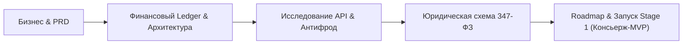

# 🚀 Konveer: Главный командный Dashboard

> [!IMPORTANT]
> **Текущий этап проекта:** `Stage 0 — Architecture & Product Design` (Предварительное проектирование, бизнес-моделирование и спецификация).  
> **Принцип этапа:** Полный запрет на написание прикладного программного кода до завершения системного анализа, устранения белых пятен в API и согласования финансово-юридической схемы.

---

## 📌 Паспорт проекта

| Параметр | Значение | Статус |
| :--- | :--- | :--- |
| **Кодовое название** | **Konveer** (Рабочее; варианты в [[09 - MARKETING/Naming & Brand Identity|Naming & Brand Identity]]) | Обсуждается |
| **Суть продукта** | Двусторонний маркетплейс-эскроу шорт-форм контента (Shorts, Reels, TikTok, VK Клипы) | Утверждено |
| **Рынок запуска** | Российская Федерация (с потенциалом выхода на СНГ и Global) | Утверждено |
| **Базовая модель монетизации** | 20% комиссия (Take Rate) с рекламного пула заказчика | Утверждено |
| **Целевой стек** | Next.js (Web-кабинет рекламодателя), Telegram Mini App (Кабинет клиппера), NestJS/Fastify, PostgreSQL, Redis, S3 | Проектирование |

---

## 🧭 Навигация по базе знаний Obsidian

### 🏢 Стратегия и бизнес
* [[01 - BUSINESS/Business Model|Бизнес-модель]] — Архитектура потоков ценности, юнит-экономика и точки масштабирования.
* [[01 - BUSINESS/Market Problem & Solution|Проблема рынка и Решение]] — Почему бренды и клипперы не могут работать без платформы.
* [[01 - BUSINESS/Target Audience & Personas|Целевая аудитория и Персоны]] — Профайлы заказчиков и создателей контента.
* [[01 - BUSINESS/Competitor Analysis|Анализ конкурентов]] — Детальный разбор Whop Content Rewards, Clipster, OpenClip, кейсов Mellstroy.
* [[01 - BUSINESS/Monetization & Commission Model|Монетизация и комиссии]] — Формулы расчетов, распределение пулов, защита маржи.
* [[01 - BUSINESS/Unit Economics & Financial Projections|Юнит-экономика и сценарии]] — Пессимистичный, базовый и оптимистичный прогнозы.

### 📱 Продукт и функциональность
* [[02 - PRODUCT/PRD — Product Requirements Document|PRD (Product Requirements Document)]] — Главный документ требований к продукту.
* [[02 - PRODUCT/Clipper Cabinet Specification|Кабинет клиппера]] — Спецификация мобильного интерфейса (Telegram Mini App).
* [[02 - PRODUCT/Advertiser Cabinet Specification|Кабинет рекламодателя]] — Спецификация десктопного веб-кабинета заказчика.
* [[02 - PRODUCT/Admin Panel Specification|Административная панель]] — Инструменты антифрода, модерации и финансового аудита.
* [[02 - PRODUCT/Roles, Permissions & System States|Роли и матрица доступов (RBAC)]] — Разграничение прав и жизненные циклы сущностей.

### 🎨 Дизайн и интерфейсы
* [[03 - UX UI DESIGN/Design Philosophy & System|Философия дизайна и Дизайн-система]] — Принципы премиального минималистичного SaaS.
* [[03 - UX UI DESIGN/Mobile UX & Screen Flows (Telegram WebApp)|UX клиппера в Telegram Mini App]] — Пошаговые сценарии и карты экранов.
* [[03 - UX UI DESIGN/Desktop UX & Layouts (Advertiser & Admin)|UX рекламодателя]] — Дашборды, воронки запусков и аналитика кампаний.
* [[03 - UX UI DESIGN/Interaction, Loading & Error States|Состояния интерфейсов]] — Пустые экраны, скелетоны, ошибки валидации.

### 💳 Финансы и Ledger
* [[04 - FINANCE/Wallet & Double-Entry Ledger System|Двойная бухгалтерская запись (Ledger)]] — Защита от потери баланса и отрицательных остатков.
* [[04 - FINANCE/Campaign Budget Lifecycle|Жизненный цикл бюджета кампании]] — Эскроу, резервирование, заморозка и разблокировка.
* [[04 - FINANCE/Payment Processing & Escrow|Платежный шлюз и эквайринг]] — Пополнение баланса юрлицами и физлицами.
* [[04 - FINANCE/Withdrawal & Tax Compliance|Выплаты и интеграция с ФНС]] — Автоматические чеки самозанятых через СБП.

### 🔌 Интеграции и техническая архитектура
* [[05 - INTEGRATIONS/Social Media APIs Overview & Feasibility Matrix|Матрица реализуемости API соцсетей]] — Что доступно официально, а что требует скрапинга.
* [[05 - INTEGRATIONS/YouTube Data API Integration|YouTube Data API]] — Мониторинг Shorts без OAuth.
* [[05 - INTEGRATIONS/VK API Integration|VK API]] — Мониторинг Клипов ВКонтакте.
* [[05 - INTEGRATIONS/TikTok API & Verification Strategy|TikTok API и парсинг]] — Обход ограничений Display API.
* [[05 - INTEGRATIONS/Instagram Reels Tracking Analysis|Instagram Reels]] — Анализ ограничений Meta Graph API.
* [[08 - ARCHITECTURE/System Architecture & C4 Diagrams|Системная архитектура (C4 & Mermaid)]] — Модульный монолит, шины событий, масштабирование.
* [[08 - ARCHITECTURE/Database Architecture & ERD|Схема базы данных и ERD]] — Полная структура PostgreSQL таблиц и индексов.

### 🛡️ Безопасность, юриспруденция и риски
* [[06 - ANTI FRAUD/Fraud Detection Model & Risk Scoring|Модель антифрода и скоринг рисков]] — Защита от накруток, ботов и повторов.
* [[07 - LEGAL/Legal Structure & Regulatory Compliance (RU)|Юридическое оформление]] — Договоры, оферта, налоги и выплаты.
* [[07 - LEGAL/Advertising Law & ORD Compliance (347-FZ)|Маркировка рекламы (347-ФЗ, ЕРИР, ОРД)]] — Токенизация и отчетность.
* [[12 - RISK REGISTER/Risk Register & Mitigation Matrix|Реестр рисков]] — Вероятности, ущерб и превентивные меры.

---

## 🎯 Ближайшие приоритеты и задачи

### Статус разделов проектирования:
- [x] **00 - Главная и паспорт проекта:** Завершено (6 документов).
- [x] **01 - Бизнес-моделирование и анализ рынка:** Завершено (27 документов: unit-экономика, когорты, конкуренты, SWOT, PEST).
- [x] **02 - Спецификация продукта (PRD, кабинеты, сценарии):** Завершено (22 документа: полная детализация кабинета клиппера на 14 экранов, рекламодателя на 12 экранов, админ-панели на 15 модулей).
- [x] **03 - UX/UI архитектура и дизайн-система:** Завершено (23 документа: Design Tokens, Typography, Palette, Mobile/Desktop UX, Empty/Loading/Error states).
- [x] **04 - Финансовый Ledger и математика эскроу:** Завершено (17 документов: план счетов, двойная запись, формулы, СБП, защита от овердрафта).
- [x] **05 - Интеграции с API соцсетей и финтехом:** Завершено (18 документов: аудит по 12 критериям для YouTube, VK, TikTok, Instagram, СБП, ФНС, S3).
- [x] **06 - Архитектура антифрода и превентивной модерации:** Завершено (12 документов: формулы Risk Score, 72ч холд, выявление ботов, апелляции, страйки).
- [x] **07 - Юридический комплаенс РФ (ЕРИР, ФЗ-347, Налоги):** Завершено (19 документов: оферта, 152-ФЗ, 38-ФЗ, 347-ФЗ, ОРД, 422-ФЗ самозанятые).
- [x] **08 - Техническая архитектура и ERD:** Завершено (23 документа: C4 диаграммы, PostgreSQL схемы, BullMQ очереди, NestJS, Next.js TMA, S3).
- [x] **09 - GTM и решение проблемы Chicken-and-Egg:** Завершено (17 документов: контентные вирусные петли, реферальная система, воронки B2B).
- [x] **10 - Дорожная карта (Roadmap Stage 0 -> Stage 6):** Завершено (7 документов: критерии перехода, ресурсы, сроки, риски по фазам).
- [x] **11 - WBS и система управления задачами:** Завершено (2 документа: декомпозиция задач, реестр спринтов, матрица RACI).
- [x] **12 - Реестр рисков:** Завершено (Матрица 10 ключевых рисков с триггерами и планами купирования).
- [x] **Консолидированные мастер-документы:** Завершено (`FINAL PROJECT BLUEPRINT.md`, `Sources.md`).

---

## ⚡ Критические развилки, требующие решения основателя
1. **Основной вектор первой версии (MVP):** Запускать ли сразу все 4 платформы (YouTube, VK, TikTok, Instagram) или сфокусироваться на **YouTube Shorts + VK Клипы** (где есть 100% стабильные официальные API для чтения публичной статистики без риска блокировок парсеров)?  
   *(Рекомендация команды: начать с YouTube + VK, подключив TikTok через полуавтоматический контур верификации).*
2. **Юридическая форма выплат на старте:** Требовать ли от клипперов обязательный статус **Самозанятого (НПД)** с первого рубля или предусмотреть возможность выплат физлицам через специализированных провайдеров (Solar Staff / Jump.Finance) с удержанием дополнительной комиссии?
3. **Механика исчерпания бюджета:** Что происходит с роликом, который опубликовал клиппер, если бюджет кампании закончился до того, как ролик набрал просмотры? Подробный разбор решений в документе [[00 - HOME/Key Decisions|Ключевые решения]].
