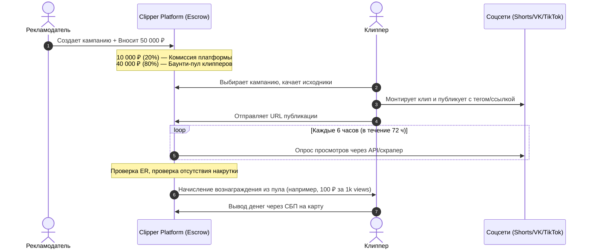

---
title: Обзор проекта (Project Overview)
type: home
status: active
priority: high
created: 2026-10-31
updated: 2026-10-31
tags:
  - konveer
  - overview
---

# 📖 Обзор проекта Konveer

## 1. Суть концепции

**Konveer** — это двусторонняя рекламная технологическая платформа (AdTech/CreatorTech), организующая децентрализованное производство и дистрибуцию коротких вертикальных видео (YouTube Shorts, VK Клипы, TikTok, Instagram Reels) по модели оплаты за подтвержденный результат (**Performance-based Content Rewards**).

Платформа решает фундаментальное противоречие современного медиарынка:
1. **Рекламодателям (бизнесу, блогерам, стримерам)** нужны миллионы органических просмотров в шорт-видео, но нанимать монтажеров в штат дорого, непредсказуемо по алгоритмам соцсетей и сложно масштабируемо.
2. **Сотням тысяч обычных людей (клипперам, студентам, начинающим видеомонтажерам)** нужны простые и быстрые деньги без сложного фриланса, переговоров с заказчиками и риска невыплаты.

Konveer объединяет их по принципу:
> **«Бизнес дает исходники и бюджет — толпа клипперов делает сотни креативов — алгоритмы соцсетей выталкивают лучшее в тренды — платформа фиксирует реальные просмотры и справедливо выплачивает деньги через эскроу»**.

---

## 2. Базовая экономическая модель (The Core Loop)

---

## 3. Ключевые метрики успеха (Target KPIs)

| Метрика | Цель к концу месяца 3 (Closed Beta) | Цель к концу месяца 6 (Public) | Цель к концу года 1 (Scaling) |
| :--- | :--- | :--- | :--- |
| **Активные рекламодатели (MAA)** | 15–20 | 100+ | 500+ |
| **Активные клипперы (MAC)** | 300–500 | 3 000+ | 25 000+ |
| **Месячный рекламный оборот (GMV)** | 750 000 ₽ | 5 000 000 ₽ | 35 000 000 ₽ |
| **Чистая выручка платформы (Take Rate 20%)** | 150 000 ₽ | 1 000 000 ₽ | 7 000 000 ₽ |
| **Суммарные подтвержденные просмотры** | 7.5 млн просмотров | 50 млн просмотров | 350 млн просмотров |
| **Средняя стоимость 1k просмотров (CPM для заказчика)** | 100 – 150 ₽ | 100 – 120 ₽ | 90 – 110 ₽ |

---

## 4. Разделение ролей и зон ответственности

* **Рекламодатель:** Отвечает за качество исходного материала, легальность своего продукта/бренда, своевременное пополнение депозита и формирование четких критериев кампании (хэштеги, призыв к действию, стоп-слова).
* **Клиппер:** Отвечает за креативный монтаж (динамика, хук в первые 3 секунды, читаемые субтитры, звуковое оформление), публикацию видео в своих аккаунтах и соблюдение правил платформы (отсутствие накрутки, неудаление видео).
* **Платформа (Мы):** Гарант безопасной сделки (эскроу), поставщик инфраструктуры (автоматический учет просмотров, антифрод-фильтрация, юридическое соответствие 347-ФЗ о маркировке рекламы, мгновенные выплаты).

Связанные документы:
- [[00 - HOME/Project Vision|Стратегическое видение продукта]]
- [[01 - BUSINESS/Business Model|Детальная бизнес-модель]]
- [[02 - PRODUCT/PRD — Product Requirements Document|Главный документ требований (PRD)]]
