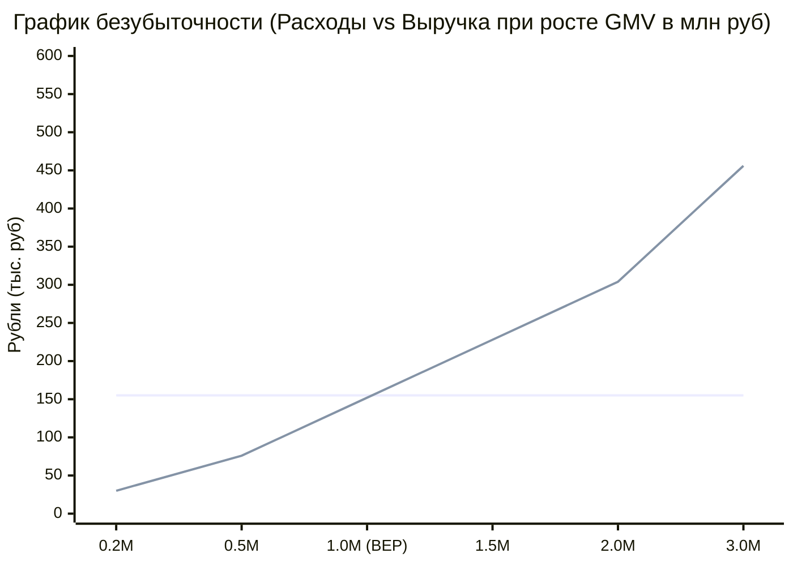

# ⚖️ Анализ точки безубыточности (Break-Even Point)

## 1. Формула точки безубыточности

Точка безубыточности ($BEP$) показывает минимальный объем оборота и количество кампаний, необходимых для полного покрытия постоянных операционных затрат ($OPEX$).

$$BEP_{\text{units}} = \frac{OPEX}{\text{Contribution Margin per Campaign}}$$

$$BEP_{\text{GMV}} = \frac{OPEX}{\text{Contribution Margin Ratio}}$$

---

## 2. Расчет для стадии MVP (Месяцы 2–4)

* **Постоянные ежемесячные затраты ($OPEX$):** **155 500 ₽ / месяц** (серверы, 2 модератора, базовый маркетинг, бухгалтерия).
* **Маржинальный доход с одной кампании чеком 50 000 ₽:**
  $$\text{Contribution Margin} = 50\,000 \times 15.2\% = \mathbf{7\,600 \text{ ₽}}$$

### Требуемый объем продаж:
$$BEP_{\text{units}} = \frac{155\,500}{7\,600} \approx \mathbf{20.4 \text{ кампаний в месяц}}$$

В денежном выражении валового оборота (GMV):
$$BEP_{\text{GMV}} = 20.4 \times 50\,000 \approx \mathbf{1\,020\,000 \text{ ₽ в месяц}}$$

*(При среднем чеке 50 000 ₽ платформе достаточно закрывать **менее 1 кампании в рабочий день** для выхода в операционный ноль!).*

---

## 3. График безубыточности

*(Серая линия — постоянные затраты 155k ₽; синяя линия — маржинальный доход платформы. Пересечение на отметке 1.0M ₽ GMV).*

Связанные документы:
- [[01 - BUSINESS/Operating Expenses & Costs|Операционные расходы]]
- [[01 - BUSINESS/Unit Economics|Юнит-экономика]]
- [[01 - BUSINESS/Growth Scenarios|Сценарии роста]]
