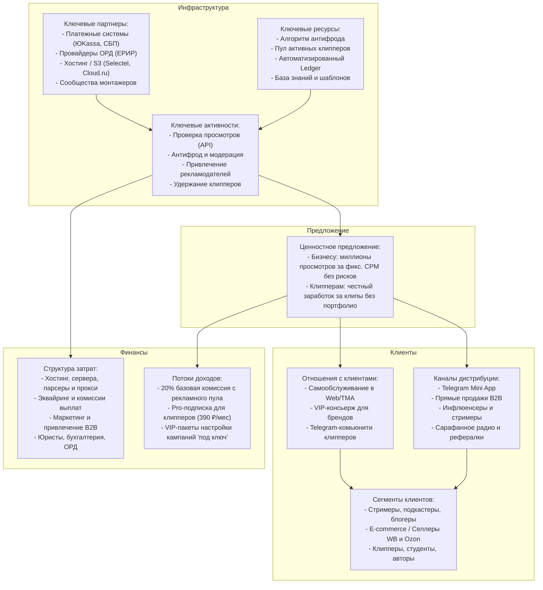

---
title: Бизнес-модель (Business Model)
type: business
status: active
priority: critical
created: 2026-10-31
updated: 2026-10-31
tags:
  - konveer
  - business
  - business-model
---

# 💼 Бизнес-модель платформы Konveer

## 1. Business Model Canvas (Бизнес-модель Остервальдера)

---

## 2. Потоки ценности и денежные потоки

1. **Заказчик (Рекламодатель):**
   * Вносит депозит $D$ (например, 100 000 ₽).
   * 20 000 ₽ (20%) удерживается платформой как вознаграждение оператора сервиса (**Take Rate**).
   * 80 000 ₽ (80%) направляются в эскроу-пул кампании для выплат клипперам.
   * Получает: органический охват в сотни тысяч или миллионы просмотров, брендинг, переход по промокодам и ссылкам, виральный эффект.

2. **Клиппер (Создатель контента):**
   * Вкладывает свое время и навык монтажа в CapCut/Premiere.
   * Не рискует собственными деньгами.
   * Получает вознаграждение по ставке CPM (например, 100 ₽ за 1 000 подтвержденных просмотров).
   * При достижении 50 000 просмотров на ролике зарабатывает 5 000 ₽ чистыми.

3. **Платформа (Мы):**
   * Обеспечивает программную среду, проверку метрик по API, защиту от накруток, юридическую чистоту и мгновенные выплаты через СБП.
   * Зарабатывает чистую маржу от 15% до 20% от совокупного оборота (GMV).

---

## 3. Масштабируемость и сетевые эффекты (Network Effects)

Платформа обладает ярко выраженным **двусторонним сетевым эффектом (Two-Sided Network Effect)**:
* Больше рекламодателей $\rightarrow$ больше разнообразных кампаний и выше бюджеты $\rightarrow$ приток лучших клипперов.
* Больше клипперов $\rightarrow$ быстрее разбираются исходники и выше конкуренция за качество $\rightarrow$ больше роликов «залетает» в топ рекомендаций алгоритмов соцсетей $\rightarrow$ рекламодатели получают сверх-результаты и увеличивают бюджеты.

Связанные документы:
- [[01 - BUSINESS/Monetization & Commission Model|Монетизация и комиссионная модель]]
- [[01 - BUSINESS/Unit Economics & Financial Projections|Юнит-экономика]]
- [[09 - MARKETING/Solving Chicken-and-Egg Problem|Решение проблемы курицы и яйца]]
