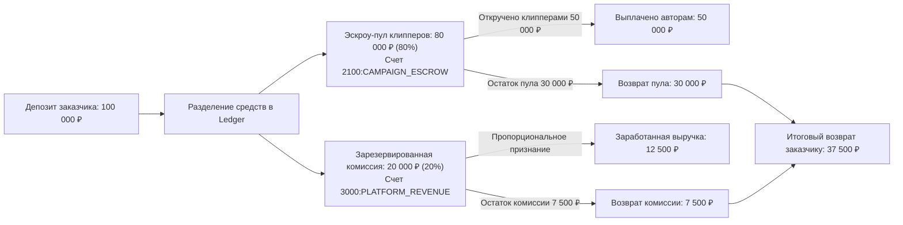

# ⚖️ Комиссионная модель и правила удержания маржи

## 1. Схема удержания и признания комиссии платформы

---

## 2. Принцип «Честной комиссии» (Earned Margin Principle)

> [!IMPORTANT]
> Платформа удерживает агентское вознаграждение **только с фактически израсходованных средств**.  
> Если кампания не освоила бюджет целиком, платформа не забирает 20% с неиспользованного остатка! Это фундаментальный фактор формирования доверия среди B2B-заказчиков и агентств.

### Математика пропорционального признания:
Пусть:
* $P_{spent}$ — сумма, фактически начисленная клипперам по подтвержденным просмотрам.
* $T_{rate} = 0.20$ — базовая комиссия платформы.

Тогда фактически заработанная выручка сервиса составляет:
$$R_{earned} = P_{spent} \times \frac{T_{rate}}{1 - T_{rate}} = P_{spent} \times \frac{0.20}{0.80} = P_{spent} \times 0.25$$

Сумма к возврату рекламодателю при отмене кампании:
$$Refund = D_{gross} - (P_{spent} + R_{earned})$$

---

## 3. Прогрессивная шкала комиссий для крупных рекламодателей

Для привлечения крупных медийных агентств и федеральных брендов действует гибкая сетка комиссий в зависимости от месячного объема (GMV):

| Месячный объем заказчика | Комиссия платформы (Take Rate) | Пул клипперов | Дополнительные опции |
| :--- | :---: | :---: | :--- |
| **Базовый (до 300 000 ₽)** | **20.0%** | 80.0% | Стандартный личный кабинет |
| **Growth (300 000 – 1 000 000 ₽)** | **16.0%** | 84.0% | Приоритетная модерация, выделенный менеджер |
| **Enterprise (от 1 000 000 ₽)** | **12.0%** | 88.0% | Индивидуальный договор, пост-оплата 14 дней, ЭДО |

Связанные документы:
- [[01 - BUSINESS/Revenue Streams|Источники дохода]]
- [[04 - FINANCE/Campaign Budget Lifecycle|Жизненный цикл бюджета]]
- [[04 - FINANCE/Financial Model & Unit Math|Финансовая математика]]
