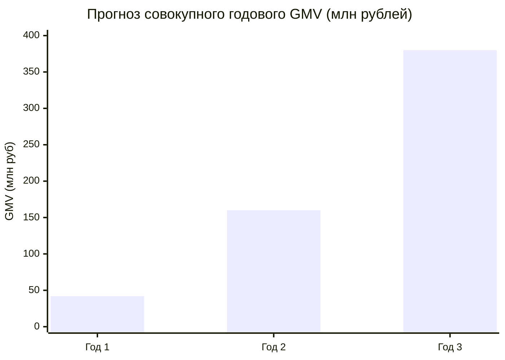

# 🚀 Сценарии роста и финансовые проекции на 3 года

## 1. Сравнительная сводка сценариев на 3 года

---

## 2. Детальное описание траекторий

### Сценарий 1: Консервативный (Органический рост без внешних инвестиций)
* **Фокус:** Только рынок РФ, только YouTube Shorts и VK Клипы, развитие исключительно на собственную операционную прибыль (Bootstrap).
* **Метрики Год 1:** 40 кампаний в месяц, месячный GMV 2.0 млн ₽, чистая прибыль фаундеров **~300 000 ₽ / мес**.
* **Метрики Год 3:** 200 кампаний в месяц, месячный GMV 10.0 млн ₽, чистая прибыль **~1 800 000 ₽ / мес**.

### Сценарий 2: Базовый (Целевой план развития)
* **Фокус:** РФ + страны СНГ (Казахстан, Беларусь), подключение e-commerce брендов Wildberries/Ozon, запуск полуавтоматического TikTok, подписка Clipper PRO.
* **Метрики Год 1:** 180 кампаний в месяц, месячный GMV 9.0 млн ₽, чистая прибыль **~1 370 000 ₽ / мес**.
* **Метрики Год 2:** 500 кампаний в месяц, месячный GMV 28.0 млн ₽, чистая прибыль **~4 800 000 ₽ / мес**.
* **Метрики Год 3:** 1 200 кампаний в месяц, месячный GMV 75.0 млн ₽, чистая прибыль **~14 000 000 ₽ / мес**.

### Сценарий 3: Агрессивный (Привлечение венчурного раунда Seed / Round A)
* **Фокус:** Встроенный собственный AI-видеоредактор (автогенерация клипов за 60 секунд), международный клиринг (USDT), выход на рынки MENA и LATAM.
* **Метрики Год 3:** 350+ млн ₽ годового GMV, трансформация в глобальную платформу шорт-форм AdTech.

Связанные документы:
- [[01 - BUSINESS/Break-Even Analysis|Точка безубыточности]]
- [[01 - BUSINESS/Unit Economics|Юнит-экономика]]
- [[10 - ROADMAP/Master Roadmap & Phased Execution|Мастер-роадмап]]
