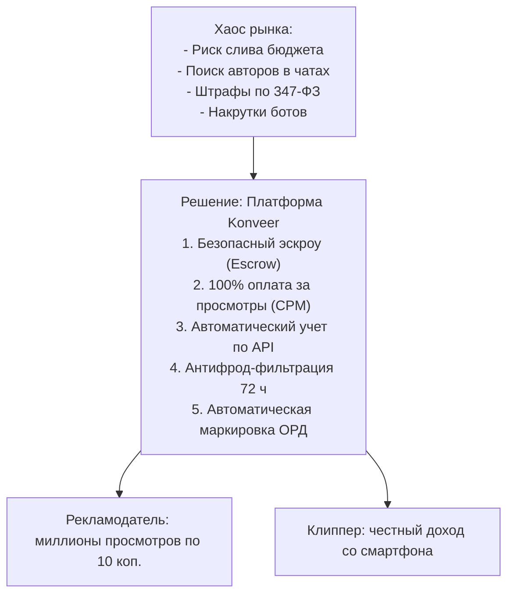

# 🟢 Решение проблемы рынка: Платформа Konveer

## 1. Концепция децентрализованной фабрики контента

Konveer решает системный кризис рынка за счет перехода от модели «один автор на зарплате» к модели **«децентрализованный краудсорсинг с оплатой за подтвержденные просмотры (Performance-Based Content Rewards)»**.

---

## 2. Ключевые столпы решения

1. **Диверсификация алгоритмического риска (Алгоритмический хедж):**
   * Вместо 15 роликов от одного штатного сотрудника кампания генерирует 150–300 разных нарезок от 50 авторов. По теории вероятностей 10–20 из них гарантированно подхватываются рекомендательными алгоритмами YouTube Shorts и VK Клипов, обеспечивая взрывной охват.
2. **Экономическая справедливость (Pay-Per-View):**
   * Бизнес больше не платит за «время монтажера». Оплата начисляется строго пропорционально вовлечению зрителей.
3. **Автоматизация под ключ:**
   * Сервис берет на себя рутину: сбор ссылок, опрос API каждые 6 часов, расчет дельты просмотров, проверку ER на ботов, выплаты по СБП и передачу отчетов в ЕРИР.

Связанные документы:
- [[01 - BUSINESS/Market Problem|Проблема рынка]]
- [[01 - BUSINESS/Value Proposition|Ценностное предложение]]
- [[01 - BUSINESS/Business Model|Бизнес-модель]]
