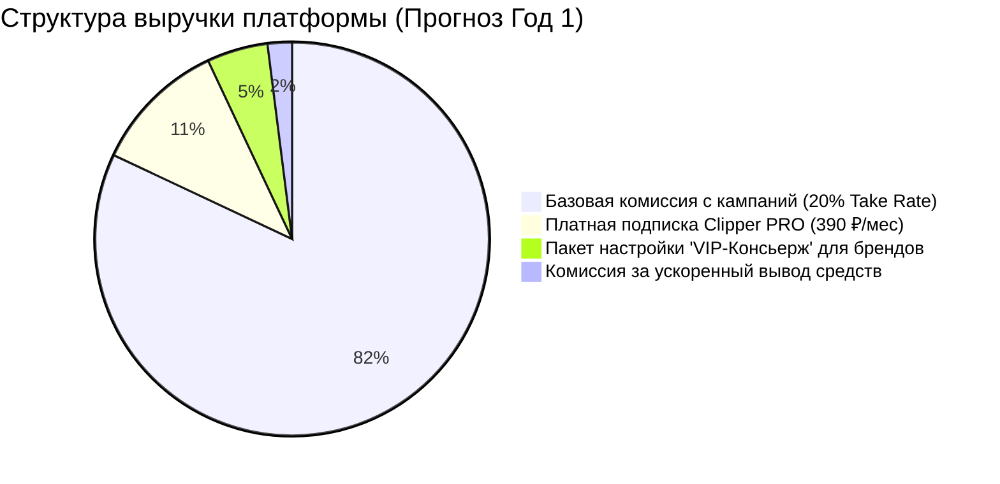

---
title: Монетизация и комиссионная модель (Monetization & Commission Model)
type: business
status: active
priority: critical
created: 2026-10-31
updated: 2026-10-31
tags:
  - konveer
  - monetization
  - finance
  - economics
---

# 💰 Монетизация и комиссионная модель

## 1. Главные источники дохода платформы

1. **Базовая комиссия с рекламного пула (Primary Revenue):** 
   * Ставка: **20%** от совокупного депозита рекламодателя.
   * Формула распределения: при пополнении на сумму $D_{gross}$, рекламный баунти-пул клипперов составляет $P_{pool} = D_{gross} \times 0.80$, доход платформы составляет $R_{platform} = D_{gross} \times 0.20$.
2. **Clipper PRO подписка (SaaS Revenue):**
   * Стоимость: **390 ₽ в месяц**.
   * Ценность для клиппера: ранний доступ к новым кампаниям за 24 часа до общей ленты, увеличенный лимит на количество активных роликов в работе, приоритетная модерация сабмитов (до 6 часов вместо 24 часов), сниженная комиссия при выводе.
3. **B2B VIP-сервис «Кампания под ключ» (Service Revenue):**
   * Стоимость: **от 15 000 до 35 000 ₽ за кампанию** дополнительно к рекламному бюджету.
   * Услуга: профессиональная нарезка таймкодов длинного стрима/подкаста нашими штатными редакторами, написание продающих хуков и ТЗ, персональный мониторинг кампании.
4. **Комиссия на вывод (Cashout Fee):**
   * Стандартный вывод по СБП (в течение 24 часов) — **0% для клиппера** (расходы берет на себя платформа в рамках юнит-экономики).
   * Мгновенный вывод (Instant Cashout) — **2.5%** (покрывает банковские издержки и приносит микро-маржу).

---

## 2. Математическая модель распределения вознаграждений

Чтобы исключить двойное удержание комиссии или финансовые разрывы, в системе используется строгая математика учета:

### Обозначения:
* $D_{gross}$ — общая сумма, внесенная рекламодателем (рубли).
* $T_{rate} = 0.20$ — ставка комиссии платформы (20%).
* $P_{pool} = D_{gross} \times (1 - T_{rate})$ — чистый призовой пул для клипперов.
* $CPM_{net}$ — ставка оплаты за 1 000 подтвержденных просмотров, отображаемая клипперу (например, 100 ₽).
* $V_{paid}$ — количество подтвержденных оплачиваемых просмотров ролика.
* $Cap_{video}$ — максимальный лимит вознаграждения на 1 видео (например, 5 000 ₽).

### Формула начисления клипперу за ролик $i$:
$$E_i = \min \left( \frac{V_{paid, i}}{1000} \times CPM_{net}, \; Cap_{video} \right)$$

### Инвариант бюджета кампании:
Сумма всех выплат клипперам по кампании никогда не может превысить чистый пул:
$$\sum_{i=1}^{N} E_i \le P_{pool}$$

Если кампания завершается, а в пуле остался неизрасходованный остаток:
$$P_{remaining} = P_{pool} - \sum E_i$$
Рекламодателю возвращается:
$$Refund = P_{remaining} \times \frac{1}{1 - T_{rate}} = \frac{P_{remaining}}{0.80}$$
*(То есть рекламодателю возвращается как неизрасходованный пул клипперов, так и пропорционально не заработанная комиссия платформы. Платформа берет комиссию ТОЛЬКО с реально открученного бюджета!).*

> [!IMPORTANT]
> **Принцип честной комиссии:** Платформа удерживает 20% комиссии только с фактически израсходованных средств. Если из 50 000 ₽ было откручено просмотров на 20 000 ₽ (16 000 ₽ клипперам + 4 000 ₽ платформе), остаток в 30 000 ₽ в полном объеме возвращается рекламодателю по первому требованию. Это создает беспрецедентный уровень доверия у бизнеса.

Связанные документы:
- [[01 - BUSINESS/Unit Economics & Financial Projections|Юнит-экономика]]
- [[04 - FINANCE/Campaign Budget Lifecycle|Жизненный цикл бюджета кампании]]
- [[04 - FINANCE/Wallet & Double-Entry Ledger System|Двойная бухгалтерская запись]]
