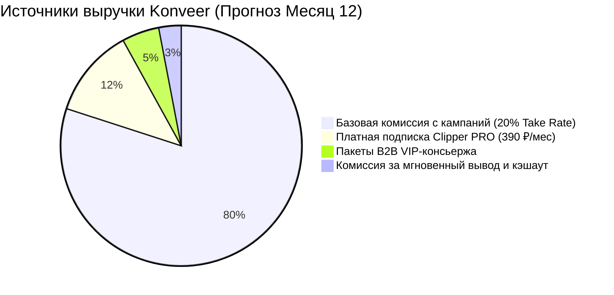

# 💵 Источники дохода платформы (Revenue Streams)

## 1. Структура монетизации платформы

---

## 2. Детальное описание каждого потока доходов

### 1. Первичный доход: Базовая комиссия маркетплейса (Take Rate 20%)
* **Механика:** При пополнении бюджета кампании заказчиком на сумму $D_{gross}$, платформа резервирует **20%** в качестве агентского вознаграждения.
* **Пример:** Депозит 100 000 ₽ $\rightarrow$ 80 000 ₽ уходит клипперам в призовой фонд, **20 000 ₽** — валовая выручка платформы.

### 2. Подписочный доход (SaaS): Подписка Clipper PRO
* **Стоимость:** **390 ₽ в месяц**.
* **Ценность для клиппера:**
  * Доступ к эксклюзивным кампаниям с повышенным CPM за 24 часа до общей ленты.
  * Увеличение лимита активных роликов в работе с 3 до 10.
  * Сокращенное время проверки и ускоренный разбор апелляций (до 6 часов вместо 24 часов).
* **Прогноз:** На 10 000 активных авторов около 8–10% оформляют PRO-статус $\rightarrow$ **312 000 – 390 000 ₽/мес** чистой подписочной выручки (MRR).

### 3. Сервисный доход: Пакет «VIP-Кампания под ключ»
* **Стоимость:** **от 15 000 до 35 000 ₽** поверх рекламного депозита.
* **Услуга:** Штатные контент-редакторы сервиса сами размечают стримы заказчика, пишут продающие хуки, генерируют промокоды и вручную модерируют ролики.

### 4. Финтех-маржа: Комиссия за мгновенный вывод (Instant Payout Fee)
* Стандартный вывод по СБП (в течение 24 ч) — **0% для клиппера**.
* Мгновенный вывод (Instant Cashout за 60 секунд) — **2.5%** от суммы вывода.

Связанные документы:
- [[01 - BUSINESS/Commission Model|Комиссионная модель]]
- [[01 - BUSINESS/Unit Economics|Юнит-экономика]]
- [[04 - FINANCE/Financial Model & Unit Math|Финансовая математика]]
