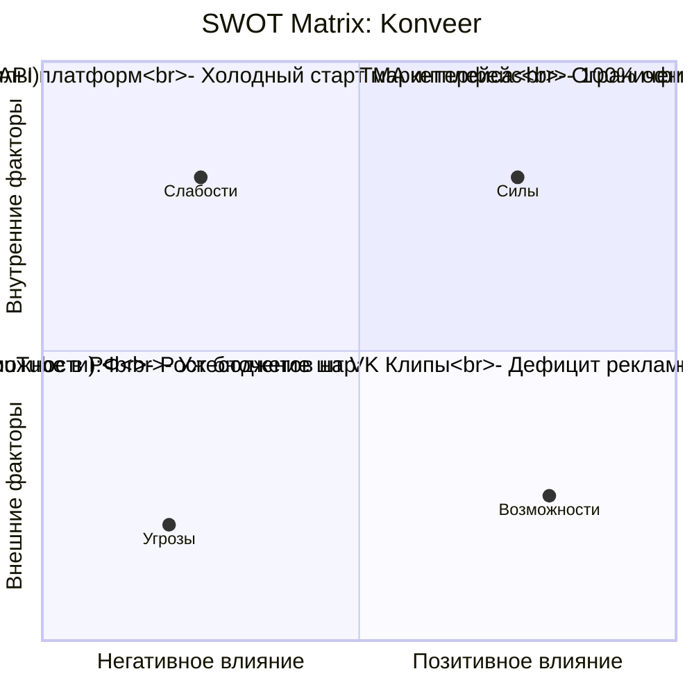

---
title: SWOT и PEST Анализ (SWOT & PEST Analysis)
type: business
status: active
priority: medium
created: 2026-10-31
updated: 2026-10-31
tags:
  - konveer
  - swot
  - pest
  - strategy
---

# 📊 SWOT и PEST Анализ

## 1. SWOT-Анализ

### Детальная расшифровка:

* **Сильные стороны (Strengths):**
  * Защита от дезинтермедиации за счет распределенного пула исполнителей (заказчик не может нанять 500 человек в штат).
  * Минимальные транзакционные издержки благодаря интеграции с СБП и статусом самозанятых.
  * Высокая маржинальность (до 20% валовой комиссии при незначительных серверных расходах на транзакцию).
* **Слабые стороны (Weaknesses):**
  * Проблема «курицы и яйца» на первых неделях (нужно вручную привлекать и тех, и других).
  * Необходимость постоянного мониторинга соцсетей на предмет списания просмотров и антифрода.
* **Возможности (Opportunities):**
  * В РФ образовался вакуум качественных рекламных каналов после ухода Google Ads и блокировки таргета Instagram. Компании ищут охваты.
  * Бурный рост VK Клипов (государственная поддержка и приток пользователей).
  * Выход в нишу продвижения товаров маркетплейсов (Wildberries / Ozon).
* **Угрозы (Threats):**
  * Потенциальное замедление или блокировка YouTube на территории РФ $\rightarrow$ *Смягчение: мгновенный фокус на VK Клипы и Telegram видео*.
  * Изменения алгоритмов начисления просмотров в соцсетях $\rightarrow$ *Смягчение: модель холда на 72 часа*.

---

## 2. PEST-Анализ рынка РФ

| Фактор | Состояние среды в РФ | Влияние на платформу | Стратегический ответ |
| :--- | :--- | :--- | :--- |
| **Political (Политика)** | Регулирование рунета, требования локализации данных (152-ФЗ), реестр ЕРИР. | Высокое регулирование. Нельзя работать «в серую». | Полное соответствие закону о рекламе (347-ФЗ), интеграция с официальными ОРД, сервера в РФ. |
| **Economic (Экономика)** | Рост инфляции, поиск молодежью дополнительного дохода; рост бюджетов брендов на e-commerce. | Высокий спрос на подработку у клипперов и поиск дешевого CPM у брендов. | Позиционирование платформы как доступного источника дохода для людей и антикризисного маркетинга для бизнеса. |
| **Social (Общество)** | Доминирование вертикального шорт-видео (Клиповое мышление), популярность Telegram как главного мессенджера. | Идеальный тайминг: все умеют монтировать в CapCut и потребляют шортсы. | Запуск клиента клиппера именно в Telegram Mini App без сторонних приложений. |
| **Technological (Технологии)** | Развитие AI-инструментов монтажа (автосубтитры, нарезка), развитие Системы быстрых платежей (СБП). | Снижение себестоимости и времени производства клипа с 40 до 7 минут. | Клиппер делает больше роликов в единицу времени, повышая GMV платформы. |

Связанные документы:
- [[01 - BUSINESS/Business Risks|Бизнес-риски]]
- [[07 - LEGAL/Advertising Law & ORD Compliance (347-FZ)|Юридический комплаенс]]
- [[12 - RISK REGISTER/Risk Register & Mitigation Matrix|Реестр рисков]]
