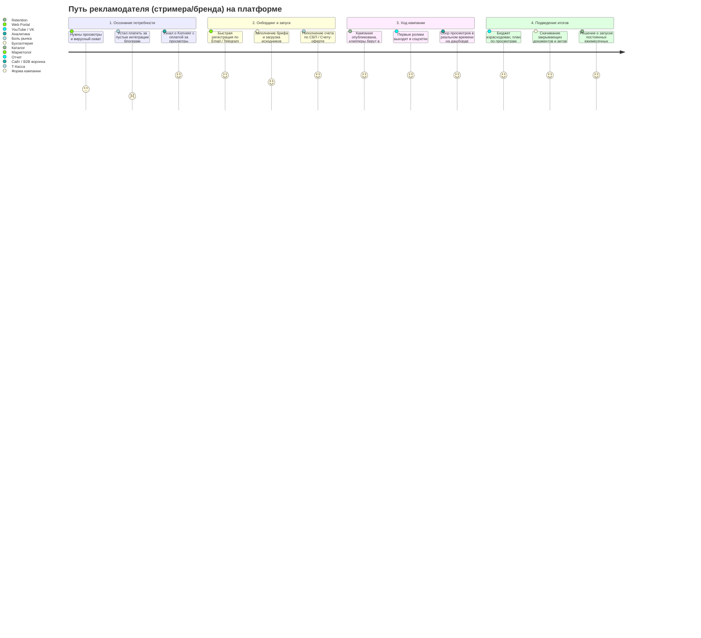

# Путь Клиента-Рекламодателя (Customer Journey Map)

Документ описывает цикл жизни рекламодателя (B2B / стример / бренд) на платформе Konveer.

---

## Карта пути рекламодателя (Advertiser CJM)

---

## Связанные документы
- [[02 - PRODUCT/User Journey|Путь клиппера]]
- [[02 - PRODUCT/Advertiser Cabinet Specification|Спецификация кабинета рекламодателя]]
- [[09 - MARKETING/Advertiser Acquisition & B2B Sales Funnel|Привлечение рекламодателей]]
