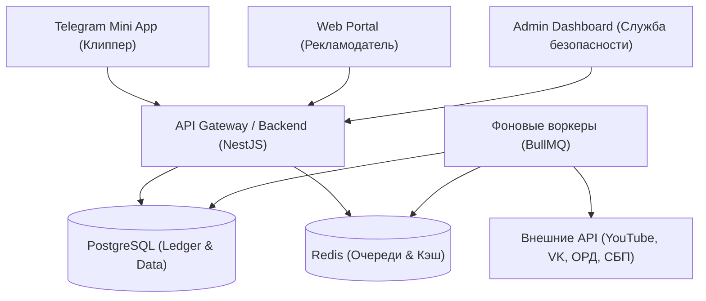

---
title: Product Requirements Document (PRD)
type: product
status: active
priority: critical
created: 2026-10-31
updated: 2026-10-31
tags:
  - konveer
  - prd
  - requirements
---

# 📋 Product Requirements Document (PRD) — Konveer

## 1. Введение и цели документа
Настоящий документ определяет функциональные, продуктовые и технические границы первой коммерческой версии платформы **Konveer (v1.0 MVP)**. Служит эталонным техническим заданием для проектирования UX/UI, схемы базы данных и API.

---

## 2. Ключевые пользовательские модули (System Modules)

Система состоит из 4 базовых подсистем:
1. **Кабинет Клиппера (Clipper App):** Реализован как Telegram Mini App (TMA).
2. **Кабинет Рекламодателя (Advertiser Portal):** Адаптивное Web-приложение для десктопа и планшетов.
3. **Административная панель (Admin & Ops):** Защищенная веб-панель для модераторов, риск-офицеров и финотдела.
4. **Фоновый движок трекинга (Verification Engine):** Асинхронные воркеры сбора статистики и управления Ledger.

---

## 3. Матрица функциональных возможностей по ролям (Feature Scope)

| Модуль | Функция | Клиппер | Рекламодатель | Администратор |
| :--- | :--- | :---: | :---: | :---: |
| **Аутентификация** | Вход через Telegram (`initData`) | ✅ | ❌ | ❌ |
| | Вход по Email / Пароль + 2FA | ❌ | ✅ | ✅ |
| **Кампании** | Просмотр каталога активных кампаний | ✅ | ❌ | ✅ |
| | Скачивание исходников и ТЗ | ✅ | ❌ | ✅ |
| | Создание новой кампании и загрузка исходников | ❌ | ✅ | ✅ |
| | Управление бюджетом и правилами (Cap, CPM) | ❌ | ✅ | ✅ |
| | Остановка кампании и возврат неизрасходованных средств | ❌ | ✅ | ✅ |
| **Сабмиты** | Отправка ссылки на опубликованный ролик | ✅ | ❌ | ✅ |
| | Просмотр текущей динамики просмотров ролика | ✅ | ✅ | ✅ |
| | Мотивированное отклонение ролика за нарушение ТЗ | ❌ | ✅ (до холда) | ✅ (всегда) |
| **Финансы** | Пополнение депозита (карты, СБП, счет юрлица) | ❌ | ✅ | ✅ |
| | Просмотр начисленных средств (Pending / Available) | ✅ | ❌ | ✅ |
| | Вывод средств на карту по СБП | ✅ | ❌ | ✅ |
| | Просмотр Ledger-журнала всех проводок | ❌ | ❌ | ✅ |
| **Модерация** | Подача апелляции при блокировке ролика | ✅ | ❌ | ✅ |
| | Разбор споров и выставление штрафов | ❌ | ❌ | ✅ |

---

## 4. Нефункциональные требования (NFR)
1. **Производительность:** Время отклика API на чтение каталога $< 150$ мс при $p95$.
2. **Масштабируемость:** Архитектура очередей BullMQ должна обеспечивать регулярный опрос до 100 000 активных ссылок в сутки без превышения лимитов внешних API.
3. **Безопасность данных:** Пароли хэшируются через Argon2id, токены сессий JWT с ротацией через Refresh Token в `HttpOnly` cookies. Полная изоляция финансовых операций в транзакциях уровня `SERIALIZABLE`.
4. **Доступность:** Uptime сервиса $\ge 99.8\%$ (не более 1.5 часов простоя в месяц).

Связанные документы:
- [[02 - PRODUCT/Clipper Cabinet Specification|Спецификация кабинета клиппера]]
- [[02 - PRODUCT/Advertiser Cabinet Specification|Спецификация кабинета рекламодателя]]
- [[04 - FINANCE/Wallet & Double-Entry Ledger System|Архитектура кошелька и балансов]]
- [[08 - ARCHITECTURE/System Architecture & C4 Diagrams|Техническая архитектура]]
