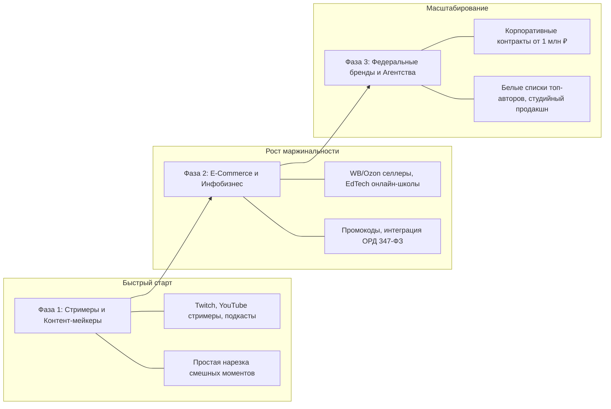

# Стратегия Продукта (Product Strategy)

Документ описывает стратегию позиционирования, фазы захвата рынка и продуктовые дифференциаторы платформы Konveer.

---

## 1. Фазы реализации продуктовой стратегии

---

## 2. Ключевые конкурентные преимущества (Moats)

1. **Бесшовный Telegram-онбординг**: Клипперы живут в Telegram. Доступ через Mini App убирает трение при регистрации до 0 секунд.
2. **Антифрод с 72-часовым холдом**: В отличие от конкурентов, сжигающих бюджеты заказчиков на бот-фермах, мы списываем просмотры только после чистки платформ.
3. **Легальность выплат в РФ (ФНС «Мой налог»)**: Полная автоматизация выплат самозанятым по СБП с генерацией чеков, освобождающая рекламодателей от 43% налоговой нагрузки.

---

## Связанные документы
- [[02 - PRODUCT/Product Vision|Видение продукта]]
- [[10 - ROADMAP/Master Roadmap & Phased Execution|Мастер-роадмап]]
- [[01 - BUSINESS/Competitor Analysis|Анализ конкурентов]]
