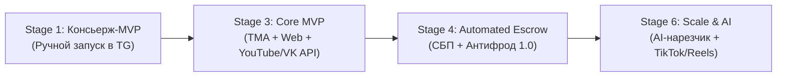

---
title: Видение и продуктовая стратегия (Product Vision & Strategy)
type: product
status: active
priority: critical
created: 2026-10-31
updated: 2026-10-31
tags:
  - konveer
  - product
  - strategy
---

# 🚀 Продуктовое видение и стратегия (Product Vision & Strategy)

## 1. Product North Star Metric (Главная метрика продукта)

$$NSM = \text{Количество подтвержденных качественных просмотров в месяц (Verified Organic Views)}$$

Почему именно эта метрика:
* Если растут подтвержденные просмотры $\rightarrow$ рекламодатели получают ценность (трафик, узнаваемость) и возвращаются с новыми бюджетами.
* Если растут просмотры $\rightarrow$ клипперы зарабатывают больше денег и приводят друзей-монтажеров.
* Платформа зарабатывает прямо пропорционально открученным просмотрам ($GMV \times 20\%$).

### Вспомогательные метрики (Input Metrics):
1. **Качество контента:** средний процент роликов, прошедших модерацию с первого раза ($>85\%$).
2. **Ликвидность кампаний:** среднее время до первого опубликованного клиппером ролика после старта кампании ($< 3$ часов).
3. **Скорость выплат:** среднее время от завершения холда до вывода средств на карту ($< 15$ минут).

---

## 2. Продуктовые принципы разработки

1. **Zero-Friction Onboarding (Нулевое трение на старте):**
   * Клиппер начинает работу в Telegram за 10 секунд без логина, пароля и ввода паспортных данных. Паспорт и статус самозанятого запрашиваются ТОЛЬКО в момент первого вывода денег.
2. **Transparency First (Абсолютная прозрачность балансов):**
   * Никаких скрытых комиссий или «внутренних кристаллов/баллов». Все балансы строго в рублях РФ. Каждое начисление привязано к конкретному URL ролика и зафиксированным просмотрам.
3. **Automated Verification (Автоматизация вместо людей):**
   * Человек-модератор привлекается только к спорам и подозрительным аномалиям (Risk Score $> 70$). 95% сабмитов валидируются программными API и алгоритмами.

---

## 3. Продуктовые релизные циклы (Phased Strategy)

Связанные документы:
- [[02 - PRODUCT/PRD — Product Requirements Document|PRD Документ]]
- [[02 - PRODUCT/Functional & Non-Functional Requirements|Требования к системе]]
- [[10 - ROADMAP/Master Roadmap & Phased Execution|Дорожная карта]]
