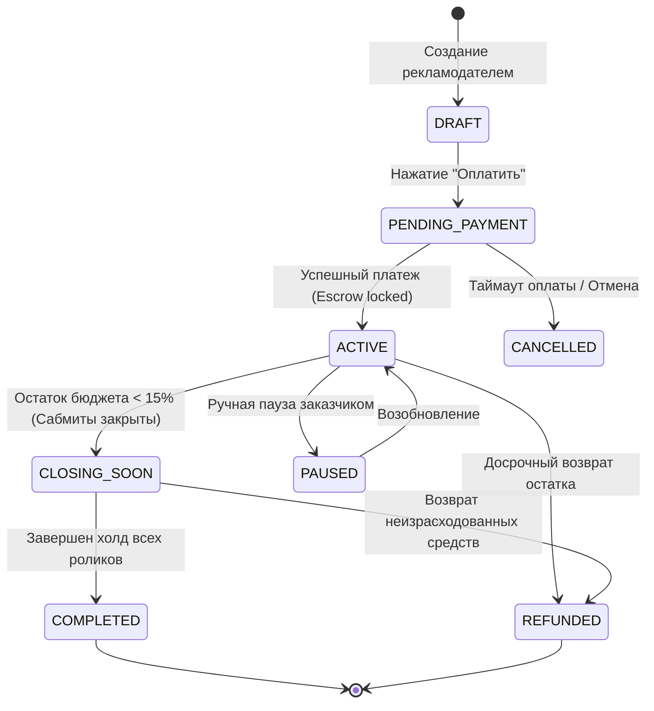
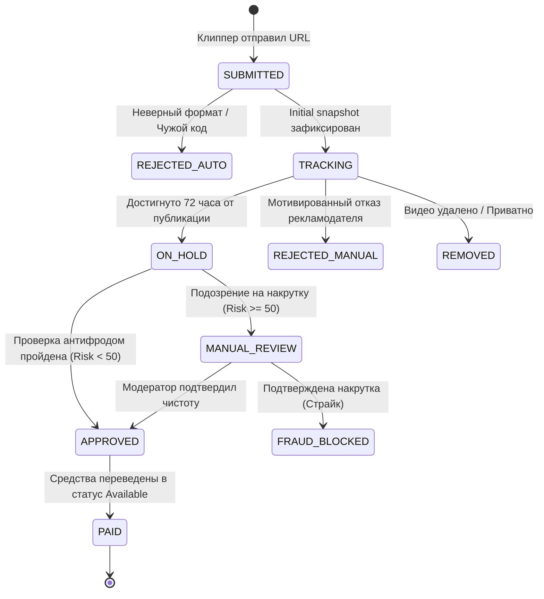

---
title: Роли, права доступа и системные состояния (RBAC & State Machines)
type: product
status: active
priority: high
created: 2026-10-31
updated: 2026-10-31
tags:
  - konveer
  - rbac
  - state-machine
---

# 🔐 Роли, права доступа и системные состояния

## 1. Ролевая модель доступа (Role-Based Access Control — RBAC)

Система определяет 4 основные пользовательские роли:
1. `GUEST` — Неавторизованный посетитель (просмотр лендинга и публичной витрины).
2. `CLIPPER` — Создатель контента (доступ только к Telegram Mini App, сабмитам и балансу).
3. `ADVERTISER` — Заказчик кампаний (доступ к веб-кабинету, созданию кампаний, биллингу и аналитике).
4. `MODERATOR` — Операционный сотрудник (проверка сабмитов с высоким Risk Score, разбор жалоб).
5. `ADMIN` — Полный доступ к финансовому Ledger, управлению комиссиями, блокировкам и системным настройкам.

---

## 2. Конечный автомат состояний кампании (Campaign State Machine)

### Описание состояний кампании:
* `DRAFT` — Черновик, редактируется заказчиком, не виден клипперам.
* `PENDING_PAYMENT` — Ожидание подтверждения транзакции от платежного шлюза.
* `ACTIVE` — Кампания открыта в каталоге, клипперы могут брать материалы и сдавать ссылки.
* `CLOSING_SOON` — Новые сабмиты заблокированы, воркеры докручивают просмотры уже принятых роликов.
* `PAUSED` — Временная приостановка приема ссылок заказчиком.
* `COMPLETED` — Все ролики отлежались, бюджет распределен, отчет сформирован.
* `REFUNDED` — Кампания закрыта, остаток средств возвращен на баланс заказчика.

---

## 3. Конечный автомат состояний публикации / ролика (Submission State Machine)

Связанные документы:
- [[02 - PRODUCT/PRD — Product Requirements Document|PRD]]
- [[04 - FINANCE/Campaign Budget Lifecycle|Жизненный цикл бюджета]]
- [[06 - ANTI FRAUD/Fraud Detection Model & Risk Scoring|Модель антифрода]]
