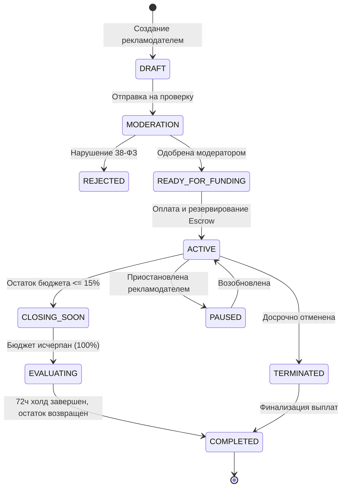
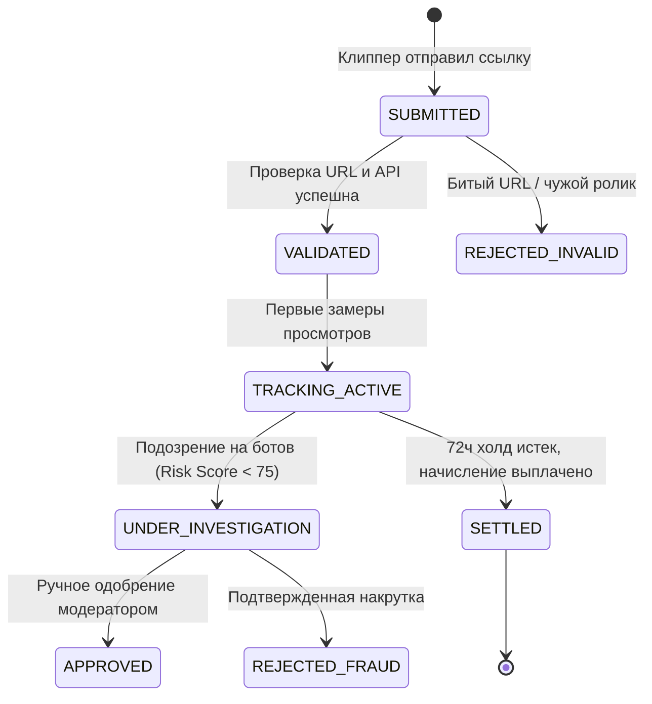

# Системные Состояния Сущностей (System States)

Документ описывает жизненные циклы ключевых доменных сущностей платформы Konveer.

---

## 1. Жизненный цикл Кампании (Campaign State Machine)

---

## 2. Жизненный цикл Ролика (Submission State Machine)

---

## Связанные документы
- [[04 - FINANCE/Financial States|Финансовые состояния]]
- [[02 - PRODUCT/Business Rules|Бизнес-правила]]
- [[06 - ANTI FRAUD/Risk Scoring|Скоринг рисков]]
