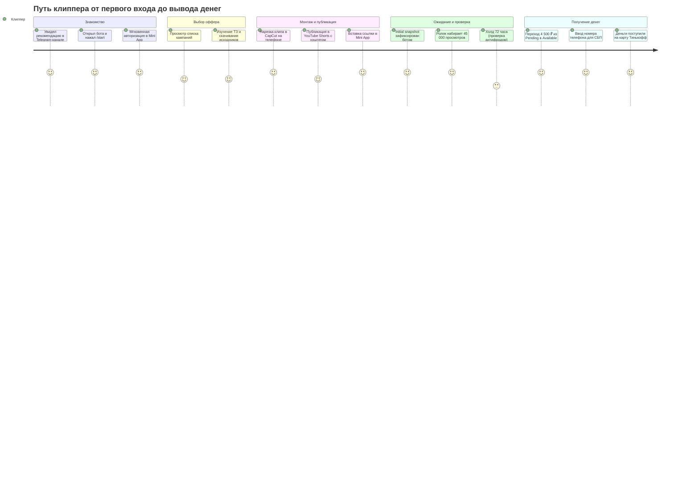
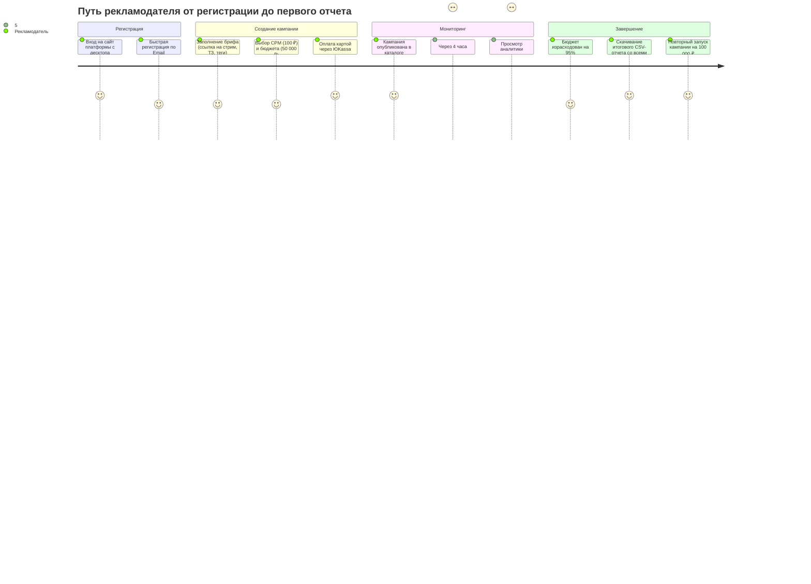

---
title: User Stories и Customer Journey Maps (CJM)
type: product
status: active
priority: high
created: 2026-10-31
updated: 2026-10-31
tags:
  - konveer
  - user-stories
  - cjm
---

# 🗺️ User Stories и Customer Journey Maps (CJM)

## 1. Сборник User Stories

### Для Клиппера (Создателя контента):
* **US-C01:** Как клиппер, я хочу открывать каталог кампаний прямо в Telegram в один клик, чтобы не тратить время на установку приложений и авторизацию.
* **US-C02:** Как клиппер, я хочу фильтровать кампании по ставке CPM, оставшемуся бюджету и тематике, чтобы сразу находить самые прибыльные офферы.
* **US-C03:** Как клиппер, я хочу видеть персональный код верификации (`#clip_778`), чтобы вставить его в описание ролика и доказать, что ролик принадлежит мне.
* **US-C04:** Как клиппер, я хочу видеть график роста просмотров и начисления денег в реальном времени, чтобы ощущать прогресс и азарт.
* **US-C05:** Как клиппер, я хочу выводить заработанные деньги на карту любого банка РФ через СБП с минимальным порогом от 500 ₽, чтобы быстро получать вознаграждение.

### Для Рекламодателя (Заказчика):
* **US-A01:** Как рекламодатель, я хочу пополнять бюджет банковской картой или с расчетного счета юрлица с получением закрывающих документов, чтобы легально списывать расходы на маркетинг.
* **US-A02:** Как рекламодатель, я хочу задавать максимальный лимит выплаты на одно видео (Cap), чтобы один завирусившийся ролик не исчерпал весь бюджет кампании за день.
* **US-A03:** Как рекламодатель, я хочу отклонять ролики с мотивированной причиной (например, «нарушено ТЗ, нет ссылки в комментарии») в течение 24 часов, чтобы защитить бренд от некачественного контента.
* **US-A04:** Как рекламодатель, я хочу в любой момент остановить кампанию и мгновенно вернуть неизрасходованный остаток депозита, чтобы не замораживать оборотные средства.

---

## 2. Customer Journey Map (CJM) Клиппера

---

## 3. Customer Journey Map (CJM) Рекламодателя

Связанные документы:
- [[02 - PRODUCT/Clipper Cabinet Specification|Кабинет клиппера]]
- [[02 - PRODUCT/Advertiser Cabinet Specification|Кабинет рекламодателя]]
- [[03 - UX UI DESIGN/Mobile UX & Screen Flows (Telegram WebApp)|Мобильный UX]]
