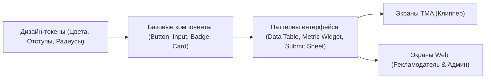

---
title: Философия дизайна и дизайн-система (Design Philosophy & System)
type: design
status: active
priority: high
created: 2026-10-31
updated: 2026-10-31
tags:
  - konveer
  - design
  - ui-ux
  - design-system
---

# 🎨 Философия дизайна и Дизайн-система

## 1. Философия визуального языка

Дизайн Konveer строится на трех фундаментальных принципах:
1. **Utility-First & Anti-Slop (Утилитарность и отказ от визуального шума):**
   * Никаких бессмысленных 3D-градиентов, избыточного неонового свечения, тяжелого размытия (glassmorphism) и украшательств ради украшательств.
   * Продукт ориентирован на деньги и цифры. Главные герои интерфейса — метрики просмотров, таймеры, прогресс-бары бюджетов и суммы в рублях.
2. **FinTech-Grade Confidence (Ощущение финансовой надежности):**
   * Интерфейс рекламодателя должен выглядеть как современный банковский терминал (уровня Stripe, Linear или Т-Бизнес): четкая табличная верстка, строгие сетки, моноширинные цифры для финансовых данных.
3. **Hyper-Focus Mobile Experience (Фокусный мобильный опыт):**
   * Мобильный клиент клиппера в Telegram Mini App спроектирован так, чтобы ключевое действие («Взял оффер $\rightarrow$ сдал ссылку») занимало минимум тапов. Высокие зоны клика (минимум 44x44px), понятные статусы с виброоткликом (Haptic Feedback).

---

## 2. Архитектура тем оформления

Система поддерживает две темы:
* **Dark Theme (По умолчанию для Telegram Mini App):** Глубокий темный фон без синевы (`#0D0F12`), мягкие серые карточки (`#161A1F`), контрастный белый текст (`#F4F6F8`) и изумрудно-зеленый акцент для денег (`#10B981`).
* **Light Theme (Для корпоративного Web-кабинета):** Чистый белый фон (`#FFFFFF`), нейтральные серые границы (`#E2E8F0`), графитовый текст (`#0F172A`) и акцентный индиго/электрик-синий (`#2563EB`).

Связанные документы:
- [[03 - UX UI DESIGN/Design Tokens & Typography|Токены и типографика]]
- [[03 - UX UI DESIGN/Mobile UX & Screen Flows (Telegram WebApp)|Мобильный UX]]
- [[03 - UX UI DESIGN/Desktop UX & Layouts (Advertiser & Admin)|Десктопный UX]]
