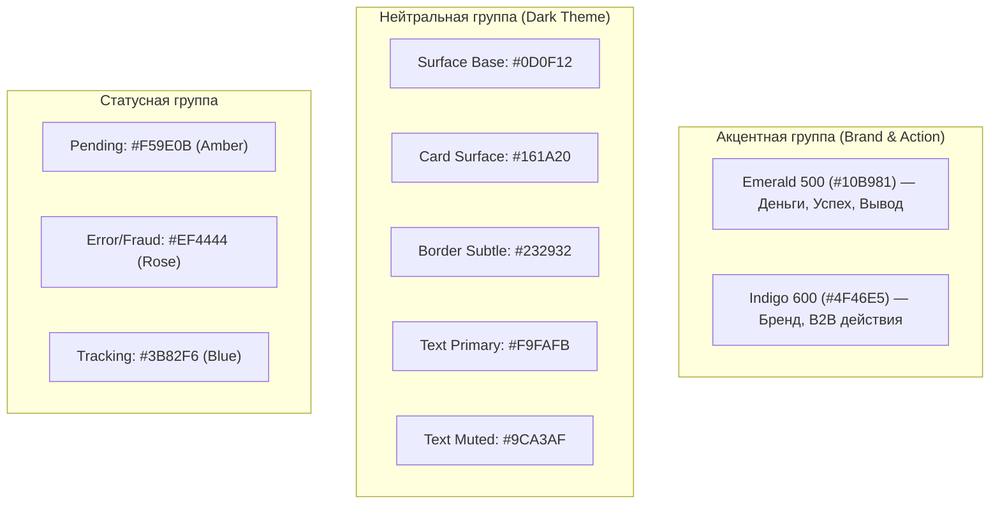

---
title: Дизайн-токены и типографика (Design Tokens & Typography)
type: design
status: active
priority: high
created: 2026-10-31
updated: 2026-10-31
tags:
  - konveer
  - design-tokens
  - typography
---

# 🎨 Дизайн-токены и типографика

## 1. Цветовая палитра (Color Palette Tokens)



### Значения токенов (CSS Custom Properties):

```css
:root {
  /* Нейтральные (Dark Theme Default для TMA) */
  --bg-app: #0D0F12;
  --bg-card: #161A20;
  --bg-card-hover: #1E232B;
  --border-subtle: #232932;
  --border-strong: #374151;
  
  /* Текст */
  --text-primary: #F9FAFB;
  --text-secondary: #9CA3AF;
  --text-tertiary: #6B7280;

  /* Акценты */
  --accent-money: #10B981;
  --accent-money-hover: #059669;
  --accent-brand: #4F46E5;
  --accent-brand-hover: #4338CA;

  /* Статусы */
  --status-pending: #F59E0B;
  --status-success: #10B981;
  --status-danger: #EF4444;
  --status-info: #3B82F6;

  /* Радиусы скругления */
  --radius-sm: 6px;
  --radius-md: 10px;
  --radius-lg: 16px;
  --radius-full: 9999px;
}
```

---

## 2. Шрифтовая система (Typography)

* **Основной шрифт интерфейса:** **Inter** (чистый, нейтральный гротеск с превосходной читаемостью на экранах смартфонов).
* **Шрифт для чисел, сумм и балансов:** **JetBrains Mono** или **Geist Mono** (моноширинные цифры предотвращают «прыгание» строк при обновлении счетчиков просмотров и рублей).

### Шкалы типографики:

| Стилистический класс | Размер / Line Height | Начертание | Применение |
| :--- | :--- | :--- | :--- |
| `display-balance` | 32px / 36px | Bold (700), Mono | Баланс кошелька, крупные цифры просмотров |
| `heading-1` | 24px / 30px | SemiBold (600) | Заголовки экранов и страниц |
| `heading-2` | 18px / 24px | SemiBold (600) | Заголовки карточек кампаний |
| `body-normal` | 14px / 20px | Regular (400) | Основной текст описаний, ТЗ, подсказки |
| `caption` | 12px / 16px | Medium (500) | Бейджи статусов, таймштампы, хэштеги |
| `code-token` | 13px / 18px | Mono (500) | Персональный код клиппера (`#clip_992`) |

Связанные документы:
- [[03 - UX UI DESIGN/Design Philosophy & System|Философия дизайна]]
- [[03 - UX UI DESIGN/Component Specifications|Спецификация компонентов]]
