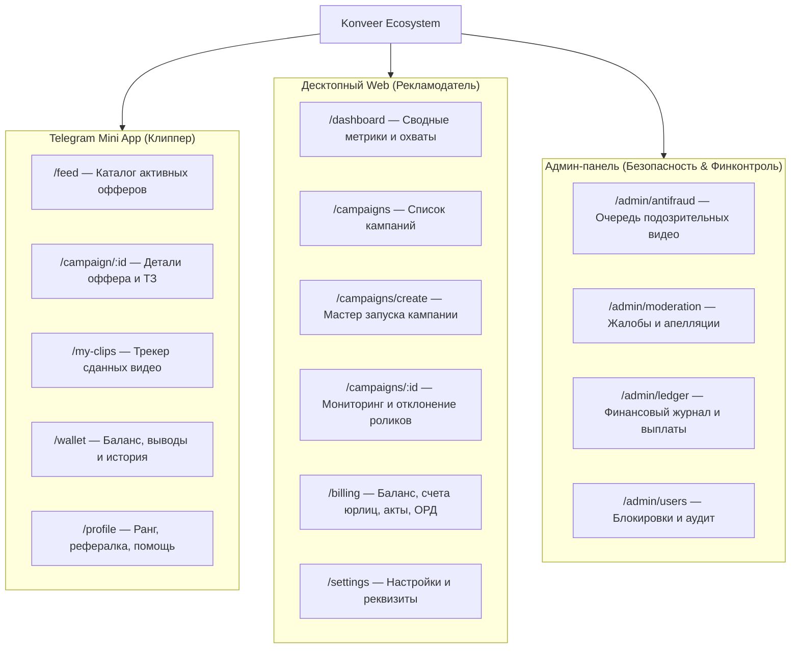

---
title: Информационная архитектура и навигация (IA & Navigation)
type: design
status: active
priority: high
created: 2026-10-31
updated: 2026-10-31
tags:
  - konveer
  - information-architecture
  - navigation
---

# 🧭 Информационная архитектура и навигация

## 1. Общая карта информационной архитектуры (Sitemap)

---

## 2. Навигационные паттерны

### Для клиппера (TMA):
* **Нижняя фиксированная панель (Bottom Navigation Bar):** 4 ключевые вкладки с крупными иконками и бейджами счетчиков:
  1. `Офферы` (Иконка Огня / Сетки)
  2. `Мои клипы` (Иконка Видео / Бейдж количества активных роликов в холде)
  3. `Кошелек` (Иконка Бумажника / Зеленая точка при наличии доступных средств)
  4. `Профиль` (Иконка Пользователя)

### Для рекламодателя (Web Portal):
* **Боковая панель (Collapsible Sidebar):** Фиксированная слева (240px в развернутом виде, 64px в свернутом). Обеспечивает быстрый доступ между дашбордом, списком кампаний и финансовым разделом.
* **Хлебные крошки (Breadcrumbs):** Позволяют моментально вернуться из аналитики конкретного ролика в кампанию и в общий список.

Связанные документы:
- [[03 - UX UI DESIGN/Mobile UX & Screen Flows (Telegram WebApp)|Мобильный UX]]
- [[03 - UX UI DESIGN/Desktop UX & Layouts (Advertiser & Admin)|Десктопный UX]]
