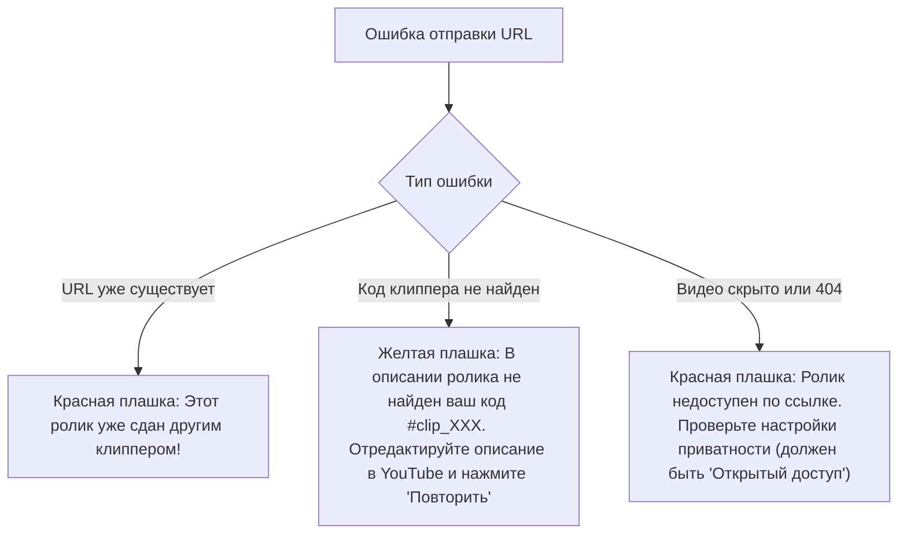

---
title: Состояния интерфейсов (Interaction, Loading & Error States)
type: design
status: active
priority: medium
created: 2026-10-31
updated: 2026-10-31
tags:
  - konveer
  - ui-states
  - error-handling
---

# 🔄 Состояния интерфейсов: Загрузка, Пустые экраны и Ошибки

## 1. Скелетоны и индикаторы загрузки (Loading States)
* **Запрет на полноэкранные спиннеры:** Вместо блокирующего крутящегося спиннера используются контентные **скелетон-заглушки (Skeleton Loaders)** с мягкой пульсацией серого цвета (`#1E232B` $\rightarrow$ `#28303B` $\rightarrow$ `#1E232B`).
* **Optimistic UI (Оптимистичные обновления):**
  * При отправке ссылки на ролик в Telegram Mini App интерфейс мгновенно добавляет карточку сабмита в список «Мои клипы» со статусом «Проверяем...», не блокируя экран пользователя ожиданиями сетевых ответов.

---

## 2. Пустые состояния (Empty States)

| Экран | Причина пустоты | Иллюстрация / Текст | Действие (CTA) |
| :--- | :--- | :--- | :--- |
| **Каталог офферов** | Нет активных кампаний в категории | Иконка сложенного сундука: *«Все кампании временно разобрали. Новые офферы появляются каждые пару часов!»* | Кнопка `Включить уведомления о новых кампаниях` |
| **Мои клипы** | Пользователь еще не сдал ни одного ролика | Иконка ножниц/видео: *«Вы еще не смонтировали ни одного ролика. Выберите кампанию и заработайте первые деньги!»* | Кнопка `Выбрать первый оффер` |
| **Кошелек** | 0 ₽ на балансе | Иконка кошелька: *«Баланс пуст. Опубликованные ролики приносят деньги по мере роста просмотров»* | Кнопка `Как увеличить просмотры? (Гайд)` |

---

## 3. Ошибки и обработка краевых случаев (Error States)

Связанные документы:
- [[03 - UX UI DESIGN/Component Specifications|Компоненты]]
- [[06 - ANTI FRAUD/Automated Verification Rules|Правила антифрода]]
