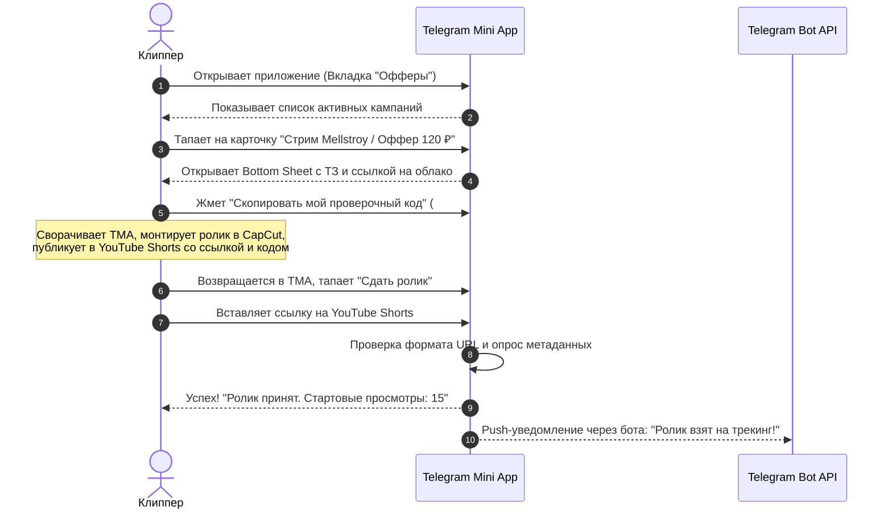

---
title: Мобильный UX и экранные сценарии TMA (Mobile UX & Screen Flows)
type: design
status: active
priority: critical
created: 2026-10-31
updated: 2026-10-31
tags:
  - konveer
  - mobile-ux
  - tma
  - wireframes
---

# 📱 Мобильный UX и экранные сценарии (Telegram Mini App)

## 1. Пошаговый сценарий: «От выбора оффера до сдачи ссылки»



---

## 2. Текстовые Wireframes ключевых мобильных экранов

### Экран А: Лента кампаний (`/feed`)
```
+------------------------------------------+
|  [Аватар]  Данил (PRO)        [ 12 450 ₽ ] |
|  --------------------------------------- |
|  [Все] [YouTube] [VK] [Топ CPM]          |
|                                          |
|  +------------------------------------+  |
|  | [Аватарка] Стрим Зубарева          |  |
|  | Категория: Юмор / Гейминг          |  |
|  | ---------------------------------- |  |
|  | СТАВКА: 130 ₽ / 1k views           |  |
|  | ОСТАЛОСЬ: 41 200 ₽ из 60 000 ₽     |  |
|  | [===========--------------]        |  |
|  | [ ВЗЯТЬ В РАБОТУ ]                 |  |
|  +------------------------------------+  |
|                                          |
|  +------------------------------------+  |
|  | [Аватарка] Косметика Mixit (WB)    |  |
|  | Категория: E-com / Распаковки      |  |
|  | ---------------------------------- |  |
|  | СТАВКА: 100 ₽ / 1k views           |  |
|  | [ ВЗЯТЬ В РАБОТУ ]                 |  |
|  +------------------------------------+  |
|                                          |
|  [ Офферы ] [ Мои клипы(2) ] [ Кошелек ] |
+------------------------------------------+
```

### Экран Б: Модальное окно сабмита видео (Submit Bottom Sheet)
```
+------------------------------------------+
|                  =====                   |
|  Сдать ролик на проверку                 |
|  Кампания: Стрим Зубарева                |
|                                          |
|  Ваш уникальный код проверки:            |
|  +------------------------------------+  |
|  | #clip_88421           [ Скопировать ] |
|  +------------------------------------+  |
|  * Должен быть в описании или комменте   |
|                                          |
|  Ссылка на опубликованное видео:         |
|  +------------------------------------+  |
|  | https://youtube.com/shorts/xY9...  |  |
|  +------------------------------------+  |
|                                          |
|  [   ПРОВЕРИТЬ И ОТПРАВИТЬ РОЛИК   ]     |
|                                          |
+------------------------------------------+
```

---

## 3. Мобильные микроинтеракции и Haptic Feedback
* При успешной отправке ссылки: виброотклик Telegram `notificationOccurred('success')`.
* При возникновении ошибки (ссылка уже есть в базе): виброотклик `notificationOccurred('error')`.
* При переключении вкладок таббара: мягкий щелчок `impactOccurred('light')`.

Связанные документы:
- [[03 - UX UI DESIGN/Component Specifications|Спецификация компонентов]]
- [[03 - UX UI DESIGN/Interaction, Loading & Error States|Состояния интерфейсов]]
- [[05 - INTEGRATIONS/Telegram Bot & Mini App Integration|Интеграция TMA]]
