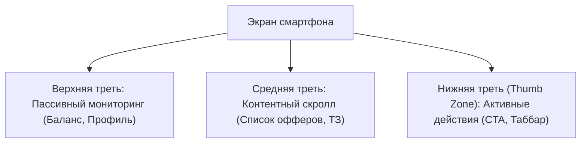

# 📱 Мобильный UX клиппера в Telegram Mini App

## 1. Эргономика под большой палец (Thumb Zone Architecture)
* Все ключевые интерактивные элементы (кнопка «Взять в работу», «Сдать ролик», нижний таббар, кнопка вывода СБП) расположены в нижней трети экрана (`Natural Thumb Reach`).
* Верхняя зона экрана используется строго для пассивного отображения сводки (баланс, аватар, прогресс-бары).

---

## 2. Мобильные микро-жесты и тактильный отклик (Haptics)
* Свайп вниз закрывает модальное окно сдачи ссылки.
* Долгий тап по персональному коду (`#clip_USERID`) копирует его с легким виброоткликом `impactOccurred('medium')`.
* Свайп вправо по карточке сданного ролика открывает быстрые действия («Поделиться ссылкой», «Статистика»).

Связанные документы:
- [[03 - UX UI DESIGN/Interaction Patterns|Паттерны взаимодействия]]
- [[03 - UX UI DESIGN/Navigation|Навигация]]
