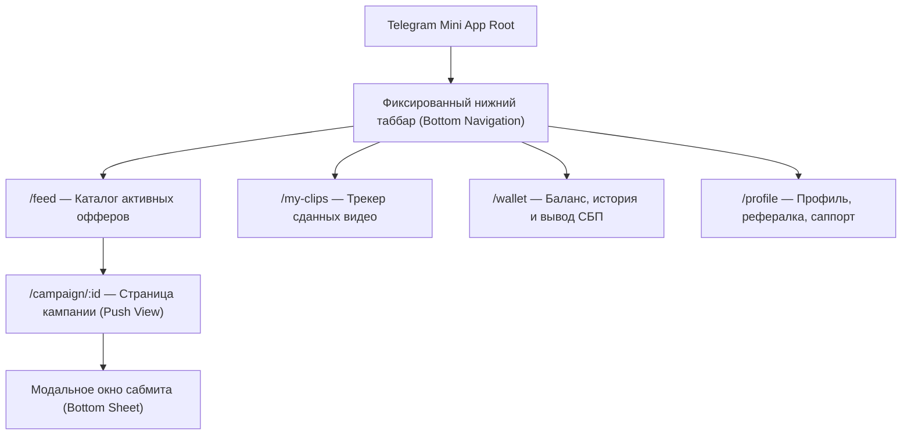

# 🧭 Навигационная архитектура и роутинг

## 1. Мобильная навигация в Telegram Mini App

* **Поддержка аппаратной кнопки Back:** При переходе вглубь экрана вызывается `window.Telegram.WebApp.BackButton.show()`. Тап по ней возвращает пользователя на предыдущий экран с анимацией сдвига слева направо.

---

## 2. Десктопная навигация в Web-кабинете рекламодателя
* **Коллапсируемый Sidebar слева:**
  * Верх: Логотип Konveer + переключатель рабочих пространств (для агентств с несколькими брендами).
  * Центр: Дашборд, Мои кампании, Запустить кампанию (+), Аналитика, Модерация роликов, Бухгалтерия и ОРД.
  * Низ: Профиль пользователя, баланс депозита, кнопка техподдержки.
* **Breadcrumbs (Хлебные крошки):** `Кампании / Подкаст #44 / Аналитика / Ролик #8841`.

Связанные документы:
- [[03 - UX UI DESIGN/Mobile UX|Мобильный UX]]
- [[03 - UX UI DESIGN/Desktop UX|Десктопный UX]]
