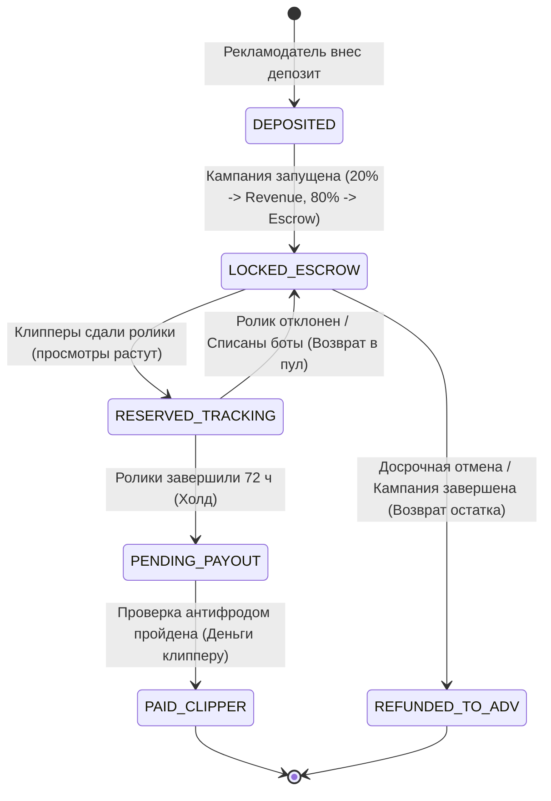

---
title: Жизненный цикл бюджета кампании (Campaign Budget Lifecycle)
type: finance
status: active
priority: high
created: 2026-10-31
updated: 2026-10-31
tags:
  - konveer
  - budget
  - lifecycle
  - escrow
---

# 🔄 Жизненный цикл бюджета кампании (Budget Lifecycle)

## 1. Фазы движения средств в кампании

---

## 2. Детальная спецификация состояний бюджета

| Фаза | Где находятся деньги | Кто имеет доступ | Условия перехода дальше |
| :--- | :--- | :--- | :--- |
| **1. Пополнение** | На счете `2000:ADV_DEPOSITS` | Рекламодатель | Рекламодатель нажимает кнопку «Запустить кампанию». |
| **2. Эскроу-блокировка** | Пул перенесен на `2100:CAMPAIGN_ESCROW`, комиссия на `3000:PLATFORM_REVENUE` | Заблокировано системой | Клипперы находят кампанию в каталоге и сдают ссылки. |
| **3. Холд-резервирование** | Перевод части пула на `2200:CLIPPER_PENDING` | Никто (заморожено на 72 ч) | Истечение таймера 72 часа + автоматическая проверка антифродом. |
| **4. Окончательное начисление** | Перевод на `2300:CLIPPER_AVAILABLE` | Клиппер | Клиппер запрашивает вывод по СБП на карту. |
| **5. Возврат остатка** | Обратный перевод с эскроу на баланс рекламодателя | Рекламодатель | Кампания истекла по времени или вручную остановлена заказчиком. |

Связанные документы:
- [[04 - FINANCE/Wallet & Double-Entry Ledger System|Ledger система]]
- [[04 - FINANCE/Financial Edge Cases & Scenarios|Краевые финансовые случаи]]
