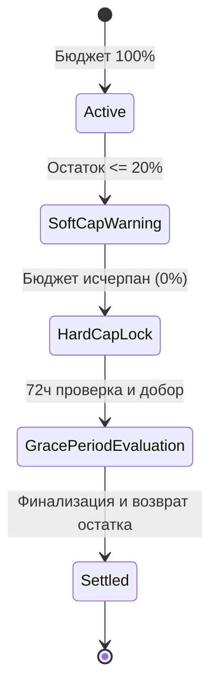

# Управление Бюджетом Кампаний (Campaign Budget Lifecycle)

Документ регламентирует правила резервирования, расходования, заморозки и возврата рекламных бюджетов на платформе **Konveer**.

---

## 1. Структура рекламного бюджета

Когда рекламодатель объявляет кампанию с бюджетом $B_{\text{total}}$ (например, 50 000 ₽):
1. **$B_{\text{total}}$ (Общий пул кампании)**:
   - Полностью холдируется в Escrow (`2100:CAMPAIGN_ESCROW_HOLD`) в момент запуска.
   - С лицевого счета рекламодателя списывается 100% заявленной суммы.
2. **Распределение пула**:
   - $B_{\text{creators}} = 80\%$ (40 000 ₽) — фонд прямого вознаграждения клипперов за подтвержденные просмотры.
   - $B_{\text{platform}} = 20\%$ (10 000 ₽) — комиссия платформы, удерживаемая пропорционально по факту набора просмотров.
3. **Ставка за показы (CPM / Rate per 1k views)**:
   - Устанавливается рекламодателем (минимальная базовая ставка: 50 ₽ за 1 000 просмотров; средняя рыночная: 100–150 ₽).
   - Например, при ставке 100 ₽ за 1 000 просмотров рекламодатель платит 100 ₽ из пула (клиппер получает 80 ₽, платформа — 20 ₽).

---

## 2. Фазы расходования бюджета и Защита от перерасхода (Budget Depletion)

Главная опасность для двустороннего маркетплейса — ситуация, когда вирусные ролики собирают миллионы просмотров за ночь, а рекламный бюджет кампании составляет всего 10 000 ₽.

Платформа решает эту проблему через 3-уровневую систему защиты:

### Уровень 1: Лимит на один ролик (Per-Video Hard Cap)
- Ни один одиночный ролик не может заработать более **10% от общего пула кампании** (или абсолютный лимит, заданный рекламодателем, например 5 000 ₽ на 1 ролик).
- Все просмотры сверх лимита продолжают приносить просмотры рекламодателю бесплатно, но клипперу начисляются достижения (Achievements), повышенный рейтинг и статус «Топ-клиппер» для приоритетного доступа к закрытым бюджетам.

### Уровень 2: Мягкий стоп (Soft Cap при остатке 15%)
- Когда в нераспределенном пуле остается $\le 15\%$ средств, статус кампании меняется на `CLOSING_SOON` (Завершается).
- Прием новых роликов по ссылке блокируется.
- Клипперы в боте получают push-уведомление: *«Кампания X собрала 85% просмотров и закрывает прием работ. Оставшийся бюджет зарезервирован под уже загруженные ролики!»*.

### Уровень 3: Жесткий стоп (Hard Cap)
- Когда сумма ожидающих начислений (`PENDING`) достигает 100% зарезервированного эскроу, кампания переводится в статус `COMPLETED_EVALUATING`.
- Запросы к API YouTube/VK продолжают фиксировать финальные цифры в течение 72 часов.
- При наличии перерасхода из-за задержек обновления API просмотры распределяются по принципу FIFO (First In, First Out по времени фиксации просмотра).

---

## 3. Досрочная остановка и возврат средств (Refunds)

Рекламодатель имеет право остановить активную кампанию в любой момент:
1. Статус кампании переводится в `PAUSED` или `TERMINATING`.
2. Прием новых роликов немедленно прекращается.
3. По всем уже одобренным роликам запускается 72-часовой таймер фиксации просмотров.
4. По истечении 72 часов все начисленные честные просмотры оплачиваются из Escrow.
5. **Весь неиспользованный остаток бюджета** возвращается на лицевой счет рекламодателя (`2000:ADV_DEPOSIT_LIABILITY`) мгновенно и без штрафов:
   $$\text{Refund Amount} = B_{\text{total}} - (\text{Paid Views Spend} + \text{Earned Commission})$$
6. Рекламодатель может повторно использовать эти деньги в других кампаниях или запросить возврат на расчетный счет / карту.

---

## Связанные документы
- [[04 - FINANCE/Ledger Architecture|Архитектура Ledger]]
- [[04 - FINANCE/Commission System|Комиссионная система]]
- [[04 - FINANCE/Financial Edge Cases|Финансовые крайние случаи]]
- [[02 - PRODUCT/Advertiser Cabinet Specification|Спецификация кабинета рекламодателя]]
