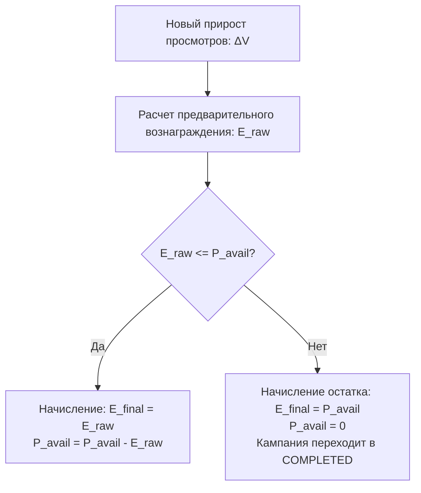

---
title: Финансовая математика и модель расчетов (Financial Math & Unit Model)
type: finance
status: active
priority: critical
created: 2026-10-31
updated: 2026-10-31
tags:
  - konveer
  - finance
  - math
  - unit-economics
---

# 📐 Финансовая математика и формулы расчетов

## 1. Базовые переменные и формулы

### Входные финансовые параметры:
* $D_{gross}$ — сумма депозита кампании, оплаченная рекламодателем (включает НДС/налоги, если применимо).
* $T_{rate} = 0.20$ — комиссия платформы (20% Take Rate).
* $P_{pool} = D_{gross} \times (1 - T_{rate})$ — чистый призовой пул для выплат клипперам.
* $R_{fee} = D_{gross} \times T_{rate}$ — резервируемая комиссия платформы.

### Параметры сабмита ролика $i$:
* $V_{initial}$ — количество просмотров ролика в момент сабмита ($T_0$).
* $V_{final}$ — количество просмотров ролика по истечении периода холда ($T_0 + 72\text{ ч}$).
* $V_{paid, i} = \max(0, \; V_{final} - V_{initial})$ — оплачиваемый прирост просмотров.
* $CPM_{net}$ — ставка вознаграждения за 1 000 просмотров (рубли).
* $Cap_{video}$ — максимальный потолок выплаты на одно видео.

### Формула вознаграждения клиппера за ролик:
$$E_i = \min \left( \left\lfloor \frac{V_{paid, i}}{1000} \right\rfloor \times CPM_{net}, \; Cap_{video} \right)$$

---

## 2. Модель распределения пула при исчерпании бюджета

Пусть $P_{avail}(t)$ — свободный нераспределенный остаток пула в момент времени $t$.

### Динамическое резервирование:
* Чтобы клиппер не смонтировал видео впустую при почти пустом пуле, при $P_{avail}(t) \le 0.15 \times P_{pool}$ кампания переводится в статус `CLOSING_SOON`. Новые сабмиты блокируются. Оставшиеся 15% бюджета зарезервированы под досмотры уже зарегистрированных видео.

---

## 3. Математика возврата неизрасходованного депозита (Refund Math)

Если кампания завершается досрочно или по истечении срока действия с нераспределенным остатком $P_{avail}$, сумма возврата рекламодателю рассчитывается так, чтобы платформа не удерживала комиссию с неоказанных услуг:

$$Refund_{total} = \frac{P_{avail}}{1 - T_{rate}} = \frac{P_{avail}}{0.80}$$

### Пример расчета:
* Рекламодатель внес 100 000 ₽ ($P_{pool} = 80\,000$ ₽, $R_{fee} = 20\,000$ ₽).
* Клипперы открутили просмотров на 50 000 ₽ ($P_{spent} = 50\,000$ ₽).
* В пуле клипперов осталось: $P_{avail} = 80\,000 - 50\,000 = 30\,000$ ₽.
* Возврат рекламодателю: $Refund = \frac{30\,000}{0.80} = \mathbf{37\,500 \text{ ₽}}$.
* Заработанная комиссия платформы: $R_{earned} = 50\,000 \times \frac{0.20}{0.80} = \mathbf{12\,500 \text{ ₽}}$.
* Проверка баланса: $50\,000 \text{ (клипперам)} + 12\,500 \text{ (платформе)} + 37\,500 \text{ (возврат)} = 100\,000 \text{ ₽}$ (Сохранение баланса выполняется идеально с точностью до копейки).

Связанные документы:
- [[04 - FINANCE/Wallet & Double-Entry Ledger System|Двойная бухгалтерская запись]]
- [[04 - FINANCE/Campaign Budget Lifecycle|Жизненный цикл бюджета]]
- [[04 - FINANCE/Financial Security & Invariants|Финансовые инварианты]]
