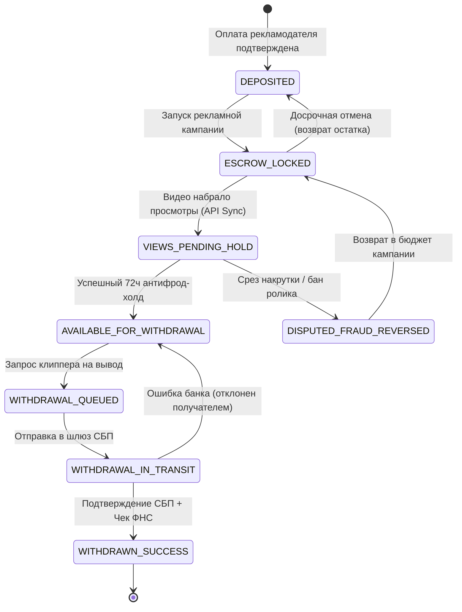

# Финансовые Состояния и Граф Переходов (Financial States)

Документ формализует конечный автомат (State Machine) движения средств на платформе **Konveer**. Никакие деньги не могут перейти в статус без явного бизнес-события и валидированной записи в Ledger.

---

## 1. Стейт-машина транзакций и средств

---

## 2. Матрица состояний и разрешенные переходы

| Состояние | Описание | Счет в Ledger | Доступные действия |
| :--- | :--- | :--- | :--- |
| **`DEPOSITED`** | Средства зачислены на баланс рекламодателя | `2000:ADV_DEPOSIT_LIABILITY` | Запуск кампаний, возврат на расчетный счет |
| **`ESCROW_LOCKED`** | Бюджет заморожен под запущенную кампанию | `2100:CAMPAIGN_ESCROW_HOLD` | Начисление клипперам, остановка кампании |
| **`VIEWS_PENDING_HOLD`** | Награда клиппера за просмотры на 72ч холде | `2200:CLIPPER_PENDING_HOLD` | Антифрод-скоринг, апелляция, срез ботов |
| **`AVAILABLE_FOR_WITHDRAWAL`** | Средства доступны к выводу | `2300:CLIPPER_AVAILABLE_BALANCE` | Подача заявки на вывод через СБП |
| **`WITHDRAWAL_QUEUED`** | Заявка ожидает обработки шлюзом | `2400:WITHDRAWAL_PROCESSING_HOLD` | Валидация ИНН в ФНС |
| **`WITHDRAWAL_IN_TRANSIT`** | Пакет отправлен в банк по СБП | `2400:WITHDRAWAL_PROCESSING_HOLD` | Ожидание callback от шлюза |
| **`WITHDRAWN_SUCCESS`** | Деньги зачислены на счет клиппера | `1002:PAYMENT_GATEWAY_PAYOUT` | Скачивание чека ФНС |
| **`DISPUTED_FRAUD_REVERSED`**| Накрутка срезана, выплата аннулирована | `2100:CAMPAIGN_ESCROW_HOLD` | Возврат в бюджет рекламодателя |

---

## Связанные документы
- [[04 - FINANCE/Ledger Architecture|Архитектура Ledger]]
- [[04 - FINANCE/Transaction Lifecycle|Жизненный цикл транзакции]]
- [[06 - ANTI FRAUD/Payout Freezing|Заморозка начислений]]
