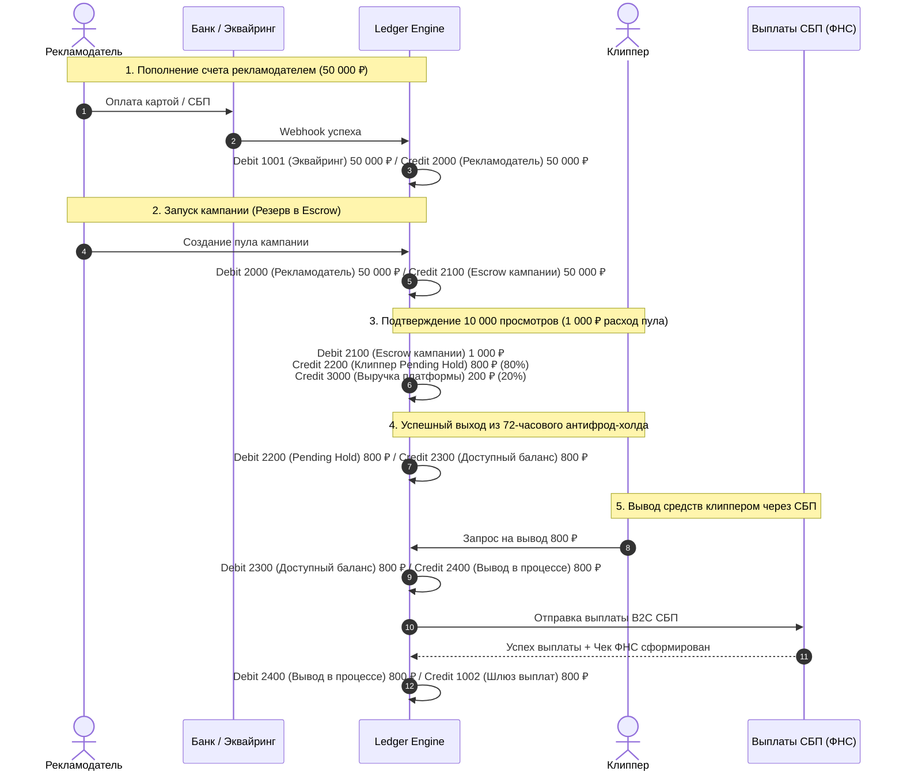

# Архитектура Неизменяемого Финансового Ledger (Double-Entry Ledger)

Данный документ описывает финансовое ядро платформы **Konveer**. Для предотвращения финансовых расхождений, ошибок округления, гонок транзакций (race conditions) и несанкционированных изменений платформа использует классическую **двойную бухгалтерскую запись (Double-Entry Bookkeeping)** с абсолютной неизменяемостью (append-only ledger).

---

## 1. Фундаментальные принципы Ledger

1. **Никаких прямых мутаций баланса (`UPDATE balance`)**:
   - Баланс пользователя или кампании никогда не меняется прямой записью.
   - Баланс — это всегда результат вычисления: $\sum (\text{Кредиты}) - \sum (\text{Дебет})$ по конкретному счету в таблице проводок `ledger_entries`.
   - Для ускорения чтения используются кэширующие таблицы материализованных остатков `account_balances`, которые обновляются строго триггером или в рамках той же ACID-транзакции.
2. **Нулевой суммарный баланс проводки (Zero-Sum Invariant)**:
   - Каждая финансовая операция состоит минимум из двух проводок (дебет одного счета и кредит другого).
   - Сумма дебетов всегда равна сумме кредитов: $\sum \text{Debit} = \sum \text{Credit}$.
3. **Неизменяемость (Append-Only & Immutability)**:
   - Записи в `ledger_transactions` и `ledger_entries` физически запрещено изменять (`UPDATE`) или удалять (`DELETE`) на уровне прав СУБД (PostgreSQL `REVOKE UPDATE, DELETE`).
   - Любая корректировка или отмена выполняется созданием компенсирующей проводки (storno).
4. **Целостность и недесятичные копейки**:
   - Все денежные суммы в базе данных хранятся строго в минимальных неделимых единицах (копейках в РФ: `BIGINT cents`, где `100.00 ₽ = 10000`).

---

## 2. План счетов платформы (Chart of Accounts)

Все счета разделены на 4 основные группы:

| Номер счета | Код счета | Класс счета | Назначение и экономический смысл |
| :--- | :--- | :--- | :--- |
| **`1000`** | `BANK_CASH_MAIN` | Asset (Актив) | Реальный расчетный счет ООО платформы в банке (Т-Банк / Точка). |
| **`1001`** | `PAYMENT_GATEWAY_ACQUIRING` | Asset (Актив) | Средства в пути от эквайринга (холдирование в Т-Кассе / ЮKassa). |
| **`1002`** | `PAYMENT_GATEWAY_PAYOUT` | Asset (Актив) | Депозит на шлюзе СБП для мгновенных выплат самозанятым. |
| **`2000`** | `ADV_DEPOSIT_LIABILITY` | Liability (Обязательство) | Свободный остаток на лицевом счете рекламодателя (до распределения в кампании). |
| **`2100`** | `CAMPAIGN_ESCROW_HOLD` | Liability (Обязательство) | Замороженные средства рекламодателя в запущенной кампании (Escrow). |
| **`2200`** | `CLIPPER_PENDING_HOLD` | Liability (Обязательство) | Начисленные клипперу средства, находящиеся на 72-часовом антифрод-холде. |
| **`2300`** | `CLIPPER_AVAILABLE_BALANCE` | Liability (Обязательство) | Доступные к выводу средства на балансе клиппера. |
| **`2400`** | `WITHDRAWAL_PROCESSING_HOLD` | Liability (Обязательство) | Средства клиппера, заблокированные в момент отправки реестра на выплату СБП. |
| **`3000`** | `PLATFORM_REVENUE_COMMISSION`| Revenue (Выручка) | Заработанная комиссия платформы (20% при расходе рекламного бюджета). |
| **`3100`** | `PAYMENT_PROCESSING_EXPENSE` | Expense (Расход) | Банковские комиссии за входящий эквайринг и выплаты СБП. |

---

## 3. Схема данных PostgreSQL

```sql
-- Таблица транзакций (заголовок финансового события)
CREATE TABLE ledger_transactions (
    id UUID PRIMARY KEY DEFAULT gen_random_uuid(),
    reference_type VARCHAR(50) NOT NULL, -- 'DEPOSIT', 'CAMPAIGN_FUND', 'VIEW_REWARD', 'PAYOUT', 'REFUND'
    reference_id UUID NOT NULL,          -- ID внешней сущности (campaign_id, submission_id, payout_id)
    description TEXT NOT NULL,
    status VARCHAR(20) NOT NULL DEFAULT 'POSTED', -- 'POSTED', 'REVERSED'
    idempotency_key VARCHAR(128) UNIQUE NOT NULL, -- Защита от повторов со стороны клиента/вебхука
    created_at TIMESTAMP WITH TIME ZONE DEFAULT NOW() NOT NULL
);

-- Таблица проводок (двойная запись)
CREATE TABLE ledger_entries (
    id UUID PRIMARY KEY DEFAULT gen_random_uuid(),
    transaction_id UUID NOT NULL REFERENCES ledger_transactions(id),
    account_code VARCHAR(32) NOT NULL,
    user_id UUID NULL,                   -- Привязка к пользователю (если субсчет)
    campaign_id UUID NULL,               -- Привязка к кампании (если эскроу)
    amount_cents BIGINT NOT NULL,        -- Положительное значение
    entry_type VARCHAR(6) NOT NULL CHECK (entry_type IN ('DEBIT', 'CREDIT')),
    created_at TIMESTAMP WITH TIME ZONE DEFAULT NOW() NOT NULL
);

-- Индексы для сверхбыстрого подсчета баланса
CREATE INDEX idx_ledger_entries_account_user ON ledger_entries(account_code, user_id);
CREATE INDEX idx_ledger_entries_campaign ON ledger_entries(campaign_id);
CREATE INDEX idx_ledger_entries_tx ON ledger_entries(transaction_id);

-- Гарантия неизменяемости на уровне БД
REVOKE UPDATE, DELETE ON ledger_transactions FROM app_user;
REVOKE UPDATE, DELETE ON ledger_entries FROM app_user;
```

---

## 4. Сквозные проводки типовых операций



---

## 5. Защита от гонок и финансовые инварианты

1. **Транзакционная блокировка `SELECT FOR UPDATE`**:
   При любых операциях списания с баланса рекламодателя или клиппера запись счета блокируется пессимистической блокировкой до завершения ACID-транзакции.
2. **Абсолютный запрет овердрафта**:
   ```sql
   -- Инвариант: баланс обязательств перед пользователем не может быть отрицательным
   ALTER TABLE account_balances ADD CONSTRAINT check_non_negative_balance CHECK (balance_cents >= 0);
   ```
3. **Автоматический ночной аудит (Nightly Reconciliation Job)**:
   Каждую ночь в 03:00 по МСК запускается фоновый скрипт сверки:
   - Сумма всех проводок в `ledger_entries` сверяется с выпиской банковских счетов `1000`, `1001`, `1002`.
   - Проверяется уравнение: $\text{Assets} = \text{Liabilities} + \text{Equity}$.
   - При обнаружении расхождения хотя бы на 1 копейку отправляется Critical Alert в Telegram дежурному архитектору, а автоматические выплаты блокируются.

---

## Связанные документы
- [[04 - FINANCE/Wallet System|Система кошельков и балансов]]
- [[04 - FINANCE/Campaign Budget|Управление бюджетом кампании]]
- [[04 - FINANCE/Commission System|Комиссионная модель платформы]]
- [[04 - FINANCE/Financial Security|Финансовая безопасность и аудит]]
- [[08 - ARCHITECTURE/Database Architecture & ERD|Архитектура базы данных PostgreSQL]]
