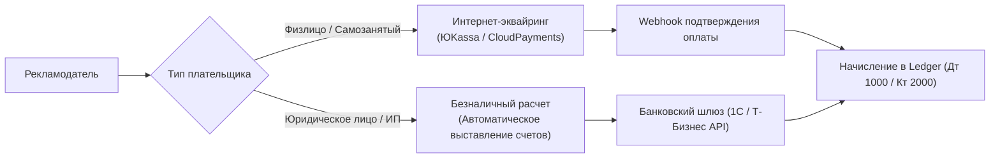

---
title: Платежный процессинг и эскроу (Payment Processing & Escrow)
type: finance
status: active
priority: critical
created: 2026-10-31
updated: 2026-10-31
tags:
  - konveer
  - payments
  - escrow
  - fintech
---

# 💳 Платежный процессинг и эскроу-механика (РФ)

## 1. Схема приема платежей от рекламодателей (Pay-In)

Платформа поддерживает два раздельных шлюза приема платежей:

### 1.1. B2C-эквайринг (Карты РФ, СБП, Mir Pay):
* Провайдер: **ЮKassa** или **CloudPayments**.
* Комиссия эквайринга: 2.8% (оплачивается заказчиком или закладывается в спред).
* Протокол: Двухстадийная оплата (Hold/Capture) при желании, либо мгновенный дебет с генерацией чека по 54-ФЗ.

### 1.2. B2B-шлюз для юридических лиц (ООО и ИП):
* Заказчик вводит ИНН в кабинете $\rightarrow$ система через API DaData подтягивает реквизиты $\rightarrow$ генерирует счет на оплату в PDF с уникальным назначением платежа (`Счет №142 от 31.10.2026, в т.ч. НДС 20% / без НДС`).
* Автоматическое распознавание платежки через банковский API Т-Банка или Точки в течение 10 минут после поступления денег.

---

## 2. Юридическая и финансовая модель эскроу

Согласно законодательству РФ, деятельность по удержанию чужих денежных средств без банковской лицензии строго регулируется (ФЗ № 161-ФЗ). 

### Легальная конструкция платформы:
Платформа выступает **Агентом** (Агентский договор публичной оферты в соответствии со ст. 1005 ГК РФ):
* Платформа действует от своего имени, но за счет Принципала (Рекламодателя).
* Денежные средства, внесенные на депозит, учитываются как **аванс принципала на исполнение агентского поручения** по привлечению клипперов и выплате им вознаграждений.
* Доход платформы (20%) признается доходом **только в момент подписания отчета агента** (по факту завершения кампании и подтверждения просмотров).
* Это полностью снимает риск обвинений в незаконной банковской деятельности или необходимости открытия номинальных счетов.

Связанные документы:
- [[04 - FINANCE/Wallet & Double-Entry Ledger System|Ledger система]]
- [[07 - LEGAL/Legal Structure & Regulatory Compliance (RU)|Юридическая структура]]
- [[07 - LEGAL/Taxation & Payout Models (Self-Employed, IP, NPD)|Налогообложение]]
