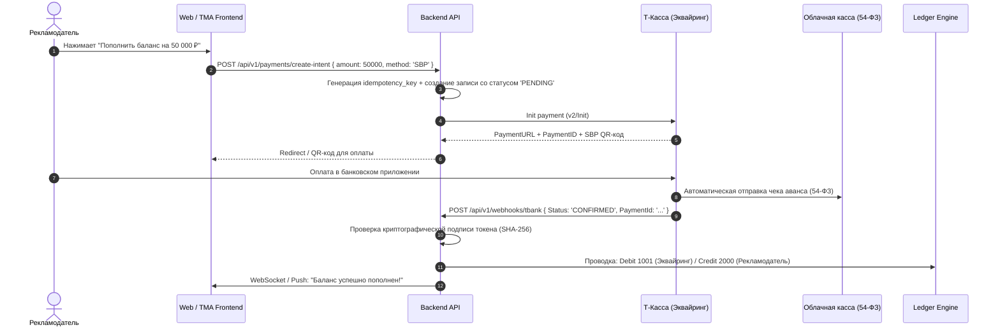

# Процессинг Платежей и Эквайринг (Payment Processing)

Документ описывает архитектуру приема входящих платежей от рекламодателей, интеграцию с российскими платёжными шлюзами, соблюдение 54-ФЗ (онлайн-кассы) и обработку банковских вебхуков.

---

## 1. Провайдеры интернет-эквайринга в РФ

Для обеспечения максимальной конверсии и надежности процессинга используется мульти-эквайринг с автоматическим failover:

| Провайдер | Основной сценарий | Комиссия | Способы оплаты | Особенности интеграции |
| :--- | :--- | :--- | :--- | :--- |
| **Т-Банк (Т-Касса)** *(Основной)* | Прием платежей от физлиц и самозанятых | 1.8% – 2.5% (СБП 0.4%–0.7%) | Банковские карты МИР/Visa/MC, СБП, T-Pay, Mir Pay | Быстрый онбординг ООО, REST API v2, встроенная облачная фискализация (Т-Бизнес) |
| **ЮKassa (Сбербанк)** *(Резервный)* | Резервный эквайринг | 2.5% – 3.2% | Карты МИР, СБП, SberPay, кошелек ЮMoney | Надежный fallback при недоступности основного шлюза |
| **Безналичный расчет B2B (Счет-оферта)** | Юрлица и ИП (бюджеты от 50 000 ₽) | 0% (комиссия банка за платежку) | Банковский перевод по реквизитам ООО | Автоматическая генерация счета-договора и актов (УПД) через Диадок / СБИС |

---

## 2. Архитектура обработки входящих платежей

---

## 3. Критические требования безопасности эквайринга

1. **Криптографическая проверка вебхуков**:
   - Ни один статус платежа не принимается без проверки подписи `Token` (хэш параметров запроса, отсортированных по алфавиту с секретным `Password` терминала).
2. **Идемпотентность зачисления**:
   - Внешний ID транзакции банка (`PaymentId`) сохраняется в таблице `payment_transactions` с ограничением уникальности `UNIQUE(external_payment_id)`.
   - Повторный приход одинакового вебхука возвращает `HTTP 200 OK`, но не создает дублирующую проводку.
3. **Фискализация по 54-ФЗ**:
   - При пополнении счета физлицом пробивается чек с признаком способа расчета «Аванс» (`payment_method_type = advance`).
   - Окончательный чек с признаком «Полный расчет» формируется в момент списания комиссии за оказанные услуги продвижения.
   - Для юрлиц (ИП/ООО) оплата по безналичному расчету освобождена от кассовых чеков (предоставляются УПД).

---

## Связанные документы
- [[04 - FINANCE/Ledger Architecture|Архитектура Ledger]]
- [[04 - FINANCE/Withdrawal System|Система выплат]]
- [[05 - INTEGRATIONS/Payment Systems (RU)|Интеграция с платёжными шлюзами]]
- [[07 - LEGAL/Payment Regulations (161-FZ)|Законодательство о платежах (161-ФЗ)]]
