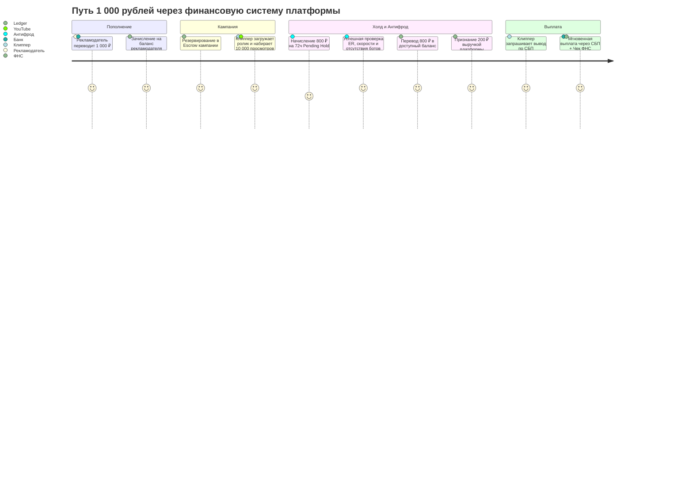

# Жизненный Цикл Транзакций (Transaction Lifecycle)

Документ описывает пошаговое прохождение транзакций в системе, правила фиксации событий (Event Sourcing) и генерацию проводок на каждом шаге.

---

## 1. Сквозной жизненный цикл от пополнения до вывода

---

## 2. Обработка сбоев и ошибок транзакций

1. **Таймаут банка при выплате**:
   - Если шлюз СБП не ответил за 30 секунд, статус транзакции переводится в `WITHDRAWAL_IN_TRANSIT`.
   - Фоновый воркер опрашивает статус выплаты через метод `GET /payouts/{id}/status` каждые 60 секунд.
   - Никаких повторных отправок без явного статуса `FAILED` (защита от двойной выплаты).
2. **Отклонение банком получателя**:
   - Если карта/счет клиппера заблокирован или закрыт, банк возвращает ошибку `ACCOUNT_BLOCKED`.
   - Система автоматически выполняет компенсирующую проводку:
     `Debit 2400 (Processing) / Credit 2300 (Available Balance)`
   - Клиппер получает уведомление с рекомендацией указать другой банк в СБП.

---

## Связанные документы
- [[04 - FINANCE/Ledger Architecture|Архитектура Ledger]]
- [[04 - FINANCE/Financial States|Финансовые состояния]]
- [[04 - FINANCE/Financial Security|Финансовая безопасность]]
