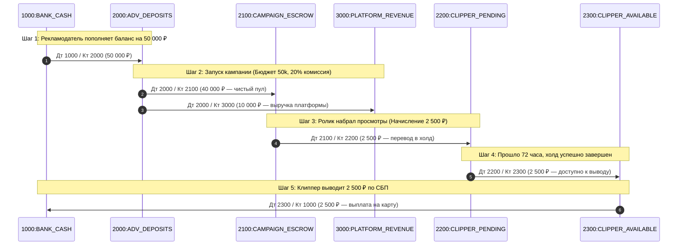

---
title: Архитектура кошелька и Ledger двойной записи (Wallet & Double-Entry Ledger)
type: finance
status: active
priority: critical
created: 2026-10-31
updated: 2026-10-31
tags:
  - konveer
  - ledger
  - fintech
  - accounting
---

# 💳 Архитектура кошелька и Ledger двойной бухгалтерской записи

## 1. Фундаментальный принцип: Почему НЕЛЬЗЯ делать `balance = balance + X`

В примитивных системах баланс пользователя хранится как числовое поле в таблице `users.balance`. При падении сервера во время транзакции, гонках запросов (race conditions) или сетевых сбоях балансы расходятся с реальностью, возникают отрицательные остатки или деньги «рисуются» из воздуха.

**В Konveer внедрен промышленный FinTech-стандарт: Неизменяемый Ledger двойной записи (Immutable Double-Entry Ledger).**

### Правила Ledger:
1. Текущий баланс любого аккаунта — это **математическая сумма всех проводок** по этому счету с момента его создания.
2. Каждая финансовая операция состоит минимум из двух записей: **Дебет (Debit)** одного счета и **Кредит (Credit)** другого счета.
3. Сумма всех дебетов в любой транзакции **строго равна** сумме всех кредитов: $\sum \text{Debit} = \sum \text{Credit}$.
4. Записи в Ledger никогда не изменяются (`UPDATE`) и не удаляются (`DELETE`). Корректировки возможны только добавлением новой компенсирующей проводки.

---

## 2. Планы счетов системы (Chart of Accounts)

| Код счета | Название счета | Тип | Описание |
| :--- | :--- | :--- | :--- |
| `1000:BANK_CASH` | Расчетный счет / Банк эквайринга | Активный (Asset) | Реальные деньги компании на счетах в банке (ЮKassa, Т-Бизнес). |
| `2000:ADV_DEPOSITS` | Свободные депозиты рекламодателей | Пассивный (Liability) | Деньги рекламодателей до запуска кампаний. |
| `2100:CAMPAIGN_ESCROW` | Эскроу-пулы активных кампаний | Пассивный (Liability) | Заблокированный бюджет запущенных кампаний. |
| `2200:CLIPPER_PENDING` | Вознаграждения клипперов в холде | Пассивный (Liability) | Деньги, начисленные за видео, проходящие 72-часовой холд. |
| `2300:CLIPPER_AVAILABLE` | Балансы клипперов к выводу | Пассивный (Liability) | Чистые средства, доступные для мгновенного вывода через СБП. |
| `3000:PLATFORM_REVENUE` | Выручка платформы (Комиссия) | Доходный (Equity/Revenue) | Заработанная комиссия платформы (20%). |
| `4000:PAYMENT_FEES` | Расходы на эквайринг и СБП | Расходный (Expense) | Банковские комиссии за переводы. |

---

## 3. Схема проводок жизненного цикла кампании



---

## 4. Схема таблицы `ledger_entries` в PostgreSQL

```sql
CREATE TABLE ledger_entries (
    id UUID PRIMARY KEY DEFAULT gen_random_uuid(),
    transaction_id UUID NOT NULL, -- Группирует парные дебет/кредит проводки
    account_id VARCHAR(64) NOT NULL, -- Например, 'clipper_wallet_UUID' или '1000:BANK'
    account_type VARCHAR(32) NOT NULL, -- ASSET, LIABILITY, REVENUE, EXPENSE
    amount_cents BIGINT NOT NULL, -- Сумма строго в копейках (целое число)!
    direction VARCHAR(6) NOT NULL CHECK (direction IN ('DEBIT', 'CREDIT')),
    reference_type VARCHAR(32) NOT NULL, -- CAMPAIGN, SUBMISSION, CASHOUT, DEPOSIT
    reference_id UUID,
    created_at TIMESTAMP WITH TIME ZONE DEFAULT NOW() NOT NULL
);

-- Индекс для мгновенного расчета баланса аккаунта
CREATE INDEX idx_ledger_account_calc ON ledger_entries (account_id, created_at);
```

Связанные документы:
- [[04 - FINANCE/Financial Model & Unit Math|Финансовая математика]]
- [[04 - FINANCE/Campaign Budget Lifecycle|Жизненный цикл бюджета]]
- [[04 - FINANCE/Financial Security & Invariants|Финансовые инварианты]]
- [[08 - ARCHITECTURE/Database Architecture & ERD|Схема БД]]
