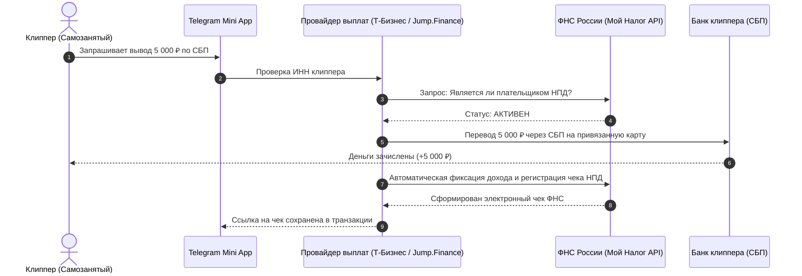

---
title: Выплаты и налоговый комплаенс (Withdrawal & Tax Compliance)
type: finance
status: active
priority: critical
created: 2026-10-31
updated: 2026-10-31
tags:
  - konveer
  - payouts
  - tax
  - sbp
---

# 💸 Выплаты клипперам и налоговый комплаенс (РФ)

## 1. Схема выплат: Выбор между Самозанятыми и Физлицами

В РФ выплата физическим лицам без статуса влечет обязанность платформы выступать налоговым агентом: удержать **13% НДФЛ** и начислить сверху **30% страховых взносов** (совокупный налоговый хвост — более 43%!). Это убивает любую экономику маркетплейса.

### Единственное легальное решение: Режим НПД (Самозанятые)

---

## 2. Интеграция с сервисами массовых выплат самозанятым

На этапе MVP платформа подключает партнерский сервис массовых выплат (**Т-Банк Выплаты самозанятым**, **Jump.Finance** или **Solar Staff**):
1. **Проверка статуса перед каждой выплатой:** Если клиппер аннулировал статус самозанятого, выплата автоматически отклоняется до повторной регистрации в приложении «Мой Налог».
2. **Автоматическая регистрация чека:** Клипперу не нужно вручную вбивать доход в «Мой Налог» — чек генерируется автоматически через Open API ФНС.
3. **Налог 6%:** При выплатах от юридического лица ставка налога составляет 6%. Клиппер оплачивает его самостоятельно в приложении ФНС в следующем месяце.

---

## 3. Резервный шлюз: Выплаты через Solar Staff для граждан СНГ / нерезидентов
* Для клипперов из Беларуси, Казахстана и Армении, у которых нет статуса самозанятого в РФ, выплаты производятся через международный финтех-агрегатор **Solar Staff**:
  * Клиппер заключает договор-оферту с Solar Staff (Кипр/ОАЭ).
  * Платформа выплачивает агентское вознаграждение B2B.
  * Solar Staff берет комиссию ~7–9% и перечисляет деньги на локальные зарубежные карты.

Связанные документы:
- [[04 - FINANCE/Payment Processing & Escrow|Платежный процессинг]]
- [[07 - LEGAL/Taxation & Payout Models (Self-Employed, IP, NPD)|Налогообложение]]
