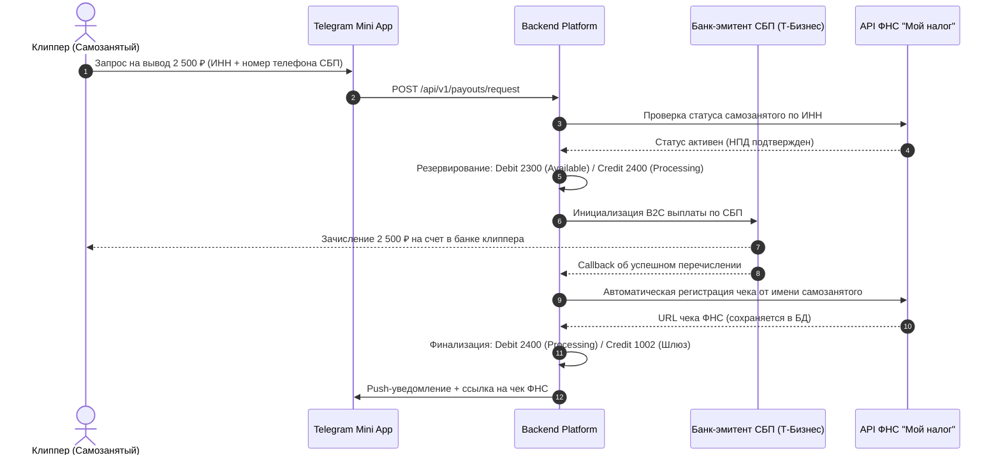

# Система Выплат Клипперам (Withdrawal System)

Документ описывает регламент, технические шлюзы и налогово-правовую схему выплат авторам видеоконтента (клипперам) на территории Российской Федерации.

---

## 1. Базовые правила выплат

1. **Минимальная сумма вывода**: 500 ₽ (для отсечения микро-транзакций с высокой удельной стоимостью банковской комиссии).
2. **Максимальный суточный лимит**:
   - Без расширенной верификации: 15 000 ₽ / сутки (в соответствии с лимитами 115-ФЗ для упрощенной идентификации).
   - С подтвержденным статусом самозанятого: 100 000 ₽ / сутки.
3. **Источники вывода**:
   - Вывод возможен строго со счета `2300:CLIPPER_AVAILABLE_BALANCE` (средства, прошедшие 72-часовой антифрод-холд).
   - Средства на статусе `2200:CLIPPER_PENDING_HOLD` вывести технически невозможно.
4. **Скорость выплаты**:
   - Мгновенно (от 5 до 60 секунд) через шлюз быстрых выплат СБП (Система Быстрых Платежей) по номеру мобильного телефона.

---

## 2. Налоговая модель: Выплаты Самозанятым (НПД, 422-ФЗ)

Для предотвращения налоговой нагрузки в 43% (13% НДФЛ + 30% страховых взносов), которая неизбежно возникает при выплатах обычным физическим лицам по договорам ГПХ, платформа работает с клипперами в статусе **Плательщиков налога на профессиональный доход (Самозанятые)**:

> [!IMPORTANT]
> **Автоматическая фискализация чека ФНС:**
> Платформа интегрируется с официальным API ФНС («Мой налог») через банк-партнер (Т-Бизнес). При выплате чек формируется автоматически от имени самозанятого, где покупателем услуг указано ООО платформы. Это гарантирует 100% налоговую чистоту расходов для платформы без ручной пересылки скриншотов.

---

## 3. Защита от мультиаккаунтов и мошенничества при выплатах

1. **Привязка ИНН к одному аккаунту**:
   - Один ИНН гражданина РФ может быть привязан только к одному аккаунту на платформе (ограничение `UNIQUE(tax_id)`).
2. **Совпадение номера телефона СБП**:
   - Номер телефона для перевода СБП сверяется с номером телефона, подтвержденным при регистрации в Telegram/SMS.
3. **Заморозка при резкой смене реквизитов**:
   - При смене номера телефона или банка получателя выплата автоматически холдируется на 24 часа для защиты от кражи аккаунтов (session hijack / bot theft).

---

## Связанные документы
- [[04 - FINANCE/Ledger Architecture|Архитектура Ledger]]
- [[04 - FINANCE/Payment Processing|Процессинг входящих платежей]]
- [[07 - LEGAL/Taxation & Payout Models (Self-Employed, IP, NPD)|Налогообложение и выплата самозанятым]]
- [[05 - INTEGRATIONS/Payout Providers|Провайдеры выплат]]
