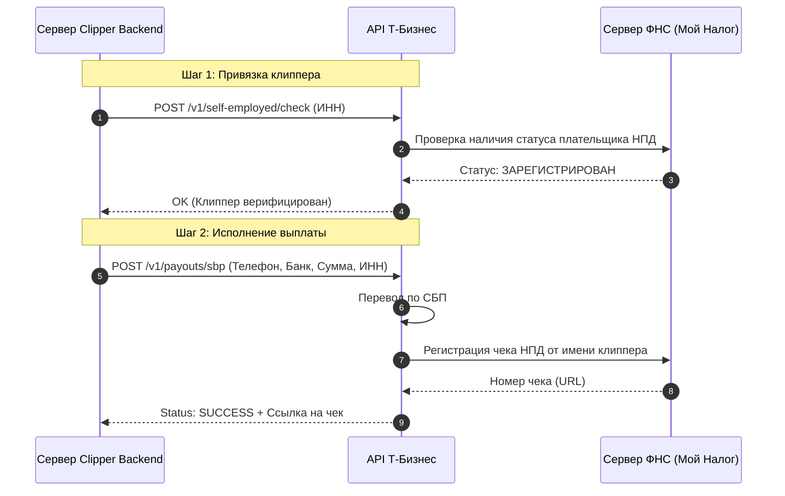

---
title: Платежные шлюзы и системы выплат в РФ (Payment Gateways & Payouts)
type: integration
status: active
priority: critical
created: 2026-10-31
updated: 2026-10-31
tags:
  - konveer
  - payments
  - sbp
  - yookassa
---

# 💳 Платежные шлюзы и системы выплат в РФ

## 1. Сравнительный анализ финтех-провайдеров для маркетплейса в РФ

| Провайдер | Входящий эквайринг (Pay-In) | Массовые выплаты (Pay-Out) | Проверка самозанятых (ФНС) | СБП выгрузка | Комиссия |
| :--- | :---: | :---: | :---: | :---: | :--- |
| **Т-Банк (Т-Бизнес API)** | ✅ (Интернет-эквайринг) | ✅ (Выплаты физлицам и самозанятым) | ✅ **Встроенная авто-фискализация в ФНС** | ✅ Мгновенно по номеру телефона | 2.6% эквайринг / 1.5% выплата |
| **ЮKassa (Сбербанк)** | ✅ (Все методы РФ, СБП, Mir Pay) | ✅ (Сервис ЮКлиент) | ⚠️ Через отдельный модуль | ✅ Да | 2.8% эквайринг / 2.0% выплата |
| **Jump.Finance** | ❌ (Только выплаты) | ✅ Специализированный шлюз | ✅ Встроенная валидация ИНН | ✅ Да | 1.8% – 2.2% за выплату |
| **Solar Staff** | ⚠️ B2B инвойсинг | ✅ Выплаты резидентам и нерезидентам | ✅ Берут налог на себя | ✅ СБП + зарубежные карты | 7% – 9% (под ключ) |

---

## 2. Архитектура интеграции с Т-Бизнес API (Целевой выбор MVP)

Выбран **Т-Банк (Т-Бизнес API)** как единый провайдер для входящих платежей и выплат самозанятым:

Связанные документы:
- [[04 - FINANCE/Payment Processing & Escrow|Платежный процессинг]]
- [[04 - FINANCE/Withdrawal & Tax Compliance|Налоги и выплаты]]
- [[07 - LEGAL/Taxation & Payout Models (Self-Employed, IP, NPD)|Налогообложение]]
