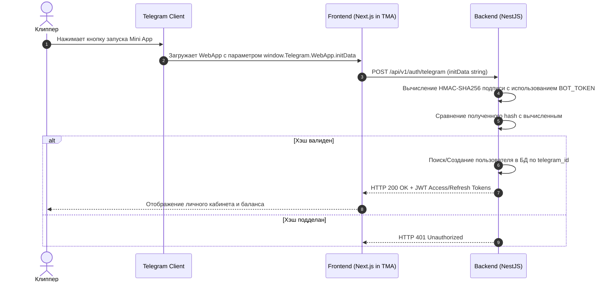

---
title: Интеграция с Telegram Bot API и Mini Apps (Telegram Integration)
type: integration
status: active
priority: critical
created: 2026-10-31
updated: 2026-10-31
tags:
  - konveer
  - telegram
  - tma
  - bot
---

# 🤖 Интеграция с Telegram Bot API и Telegram Mini App (TMA)

## 1. Архитектура аутентификации через Telegram WebApp `initData`

Безопасность авторизации клиппера строится на криптографической проверке подписи Telegram без передачи паролей:



### Код валидации `initData` на бэкенде (TypeScript/Node.js логика):
```typescript
import crypto from 'crypto';

function verifyTelegramWebAppData(telegramInitData: string, botToken: string): boolean {
  const urlParams = new URLSearchParams(telegramInitData);
  const hash = urlParams.get('hash');
  urlParams.delete('hash');

  const dataCheckString = Array.from(urlParams.entries())
    .map(([key, value]) => `${key}=${value}`)
    .sort()
    .join('\n');

  const secretKey = crypto.createHmac('sha256', 'WebAppData').update(botToken).digest();
  const calculatedHash = crypto.createHmac('sha256', secretKey).update(dataCheckString).digest('hex');

  return calculatedHash === hash;
}
```

---

## 2. Триггерные Push-уведомления через Telegram Bot API

Бот выполняет роль персонального финансового ассистента:

| Событие в системе | Текст сообщения клипперу | Кнопка быстрого действия |
| :--- | :--- | :--- |
| **Кампания в тренде** | 🔥 *Новая жирная кампания: «Подкаст #44». Ставка 130 ₽ / 1k views. Пул: 60 000 ₽!* | `[ Открыть оффер ]` |
| **Ролик принят** | ✅ *Ваш ролик принят на трекинг. Стартовые просмотры: 12. Фиксация через 72 часа.* | `[ Мои клипы ]` |
| **Всплеск просмотров** | 🚀 *Ваш ролик набрал 25 000 просмотров! Начислено: +2 500 ₽ (в холде).* | `[ Посмотреть статистику ]` |
| **Деньги доступны** | 💰 *Холд завершен! 2 500 ₽ переведены на основной баланс и доступны к выводу.* | `[ Вывести на карту ]` |
| **Успешный вывод** | 💸 *Деньги отправлены! 2 500 ₽ зачислены на ваш счет через СБП.* | `[ Чек операции ]` |

Связанные документы:
- [[02 - PRODUCT/Clipper Cabinet Specification|Кабинет клиппера]]
- [[03 - UX UI DESIGN/Mobile UX & Screen Flows (Telegram WebApp)|Мобильный UX]]
- [[08 - ARCHITECTURE/Backend Architecture & Tech Stack Selection|Бэкенд архитектура]]
