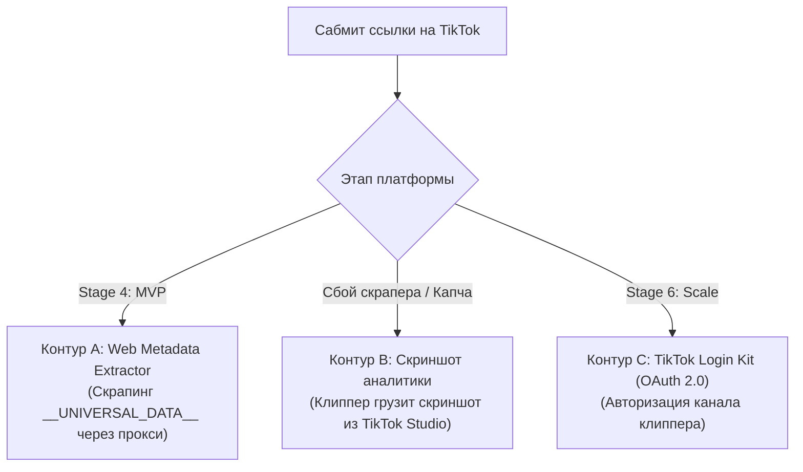

---
title: Интеграция с TikTok и стратегия верификации (TikTok API & Verification)
type: integration
status: active
priority: high
created: 2026-10-31
updated: 2026-10-31
tags:
  - konveer
  - tiktok
  - api
  - scraping
---

# 🎵 Интеграция с TikTok и стратегия верификации

## 1. Анализ ограничений официального TikTok API

В отличие от YouTube и VK, компания ByteDance не предоставляет открытого публичного API для чтения динамики просмотров произвольных роликов по ссылке:
* **TikTok Display API:** Доступен только для роликов пользователей, которые авторизовались через OAuth (Login Kit with TikTok) и дали разрешение `video.list`.
* **TikTok Research API:** Доступен исключительно академическим исследователям в США и ЕС.
* **TikTok Commercial Content API:** Предназначен для аудита платной рекламы, а не органических видео авторов.

---

## 2. Трехконтурная стратегия работы с TikTok (Гибридный подход)

Для подключения TikTok без срыва сроков запуска разработана 3-ступенчатая архитектура:

### Контур A: Автоматический экстрактор метаданных (Headless / Metadata)
* Публичная страница TikTok содержит встроенный JSON-скрипт `<script id="__UNIVERSAL_DATA_FOR_REHYDRATION__" type="application/json">`.
* Легковесный микросервис на Node.js с ротацией мобильных/резидентных прокси делает GET-запрос к странице видео и парсит `playCount`, `diggCount` (лайки) и `createTime`.
* Не требует запуска тяжелого браузера Chromium/Puppeteer в 90% случаев.

### Контур B: Полуавтоматическая верификация через скриншот (Fallback)
* Если TikTok накладывает жесткую капчу, клиппер по истечении 72 часов загружает скриншот из раздела аналитики TikTok Studio.
* OCR-модуль (Tesseract / Yandex Vision API) считывает цифры просмотров со скриншота, модератор подтверждает одним кликом.

Связанные документы:
- [[05 - INTEGRATIONS/Social Media APIs Overview & Feasibility Matrix|Матрица API]]
- [[06 - ANTI FRAUD/Fraud Detection Model & Risk Scoring|Антифрод]]
