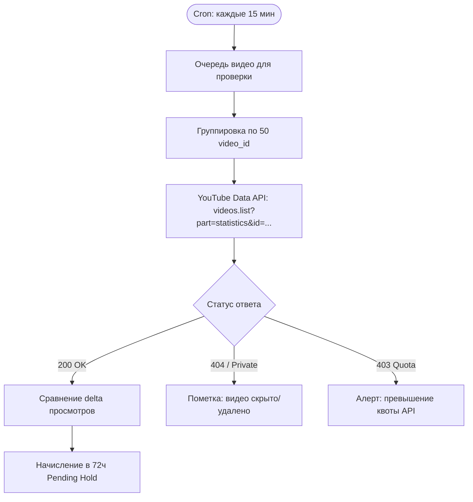

# Интеграция с YouTube Data API v3 (YouTube Data API)

Документ описывает интеграцию с Google YouTube Data API v3 для автоматического подтверждения публикаций YouTube Shorts, сбора статистики просмотров, проверки авторства и защиты от накруток.

---

## 1. Детальный аудит интеграции по 12 критериям

### 1. Возможности (Capabilities)
- Получение метаданных публичных роликов: заголовок (`snippet.title`), описание (`snippet.description`), теги, дата публикации (`snippet.publishedAt`), длительность ролика (`contentDetails.duration`), превью (`snippet.thumbnails`).
- Получение счетчиков вовлеченности: просмотры (`statistics.viewCount`), лайки (`statistics.likeCount`), комментарии (`statistics.commentCount`).
- Пакетная проверка (Batching): до 50 видео за один HTTP-запрос через параметр `id=id1,id2,id3...`.

### 2. Ограничения (Limitations)
- Не предоставляет демографию (пол, возраст, география) для чужих роликов без OAuth.
- Не предоставляет время удержания аудитории (Watch Time / Audience Retention) через Data API.
- Статистика кэшируется на серверах YouTube и обновляется с задержкой от 15 минут до нескольких часов.
- Приватные или скрытые по ссылке (unlisted) видео не отдают статистику без токена владельца канала.

### 3. Авторизация (Authorization)
- **API Key (Ключ сервиса)**: для чтения публичных видео не требуется авторизация пользователя через Google OAuth. Платформа делает серверные запросы со своим API Key.

### 4. Необходимые разрешения (Required Scopes)
- Никаких пользовательских scopes не требуется для публичных данных. Для серверного ключа в Google Cloud Console достаточно включить `YouTube Data API v3`.

### 5. Доступность статистики (Stats Availability)
- **Доступно официально и публично**: просмотры, лайки, комментарии.

### 6. Возможность проверки владельца публикации (Ownership Verification)
- **Проблема**: Data API возвращает `channelId`, но как доказать, что клиппер в Telegram действительно владеет этим YouTube-каналом?
- **Решение платформы (Верификация без OAuth)**:
  1. В момент привязки YouTube-канала клиппер получает уникальный проверочный хештег или код (например, `#konveer_verify_a8f9`).
  2. Клиппер обязан вставить этот код в описание привязываемого канала («О канале») или в описание первого загружаемого Shorts.
  3. Бэкенд проверяет наличие строки через API. После подтверждения канал привязывается к аккаунту навсегда.

### 7. Возможность получения количества просмотров (Views Retrieval)
- Полностью доступно через поле `statistics.viewCount` в ответе эндпоинта `videos.list`.

### 8. Квоты и Rate Limits (Лимиты запросов)
- Стандартная бесплатная квота Google Cloud: **10 000 единиц (units) в сутки**.
- Стоимость вызова `videos.list`: **1 unit** за запрос (независимо от того, запрашивается 1 видео или 50 видео в батче).
- **Масштабируемость**:
  - При батчинге по 50 видео 10 000 units позволяют сделать 10 000 запросов $\times 50 = 500\ 000$ проверок видео в сутки.
  - При опросе 1 000 активных роликов 1 раз в 2 часа требуется всего 12 циклов $\times 20$ запросов = 240 units в сутки (менее 2.5% от базовой квоты).
  - При росте базы подается официальная заявка на расширение квоты (Quota Extension) до 1 000 000 units/сутки (бесплатно при обосновании бизнес-кейса).

### 9. Стоимость (Pricing)
- **Бесплатно**: YouTube Data API предоставляется Google бесплатно в рамках выделяемой квоты.

### 10. Юридические ограничения (Terms of Service)
- Запрещено использовать данные YouTube для обучения сторонних моделей ИИ без согласия.
- Запрещено кэшировать метрики YouTube дольше, чем на 30 дней без обновления (наша система обновляет данные каждые 2–4 часа).
- Обязательно соблюдение YouTube Developer Terms of Service и отображение атрибуции YouTube (логотип YouTube при ссылке на ролик).

### 11. Риски (Risks)
- Риск превышения суточной квоты при резком всплеске числа клипперов (митигируется динамическим изменением интервала опроса: от 15 мин для «горячих» роликов до 6 часов для затухающих).
- Риск блокировки ключа при спам-запросах (митигируется ротацией запросов и проксированием).

### 12. Альтернативные варианты (Alternatives)
- Веб-скрейпинг через Playwright/Puppeteer (категорически не рекомендуется: капчи, частые блокировки IP, нестабильность селекторов).
- Сторонние агрегаторы данных (RapidAPI / Apify) — несут дополнительные расходы и риски утечки данных. YouTube Data API является абсолютным стандартом.

---

## 2. Архитектура цикла опроса (Sync Poller Architecture)

---

## Связанные документы
- [[05 - INTEGRATIONS/Social Media APIs Overview & Feasibility Matrix|Матрица API социальных сетей]]
- [[05 - INTEGRATIONS/YouTube Analytics API|Анализ YouTube Analytics API]]
- [[06 - ANTI FRAUD/Fraud Detection Model & Risk Scoring|Антифрод и проверка просмотров]]
