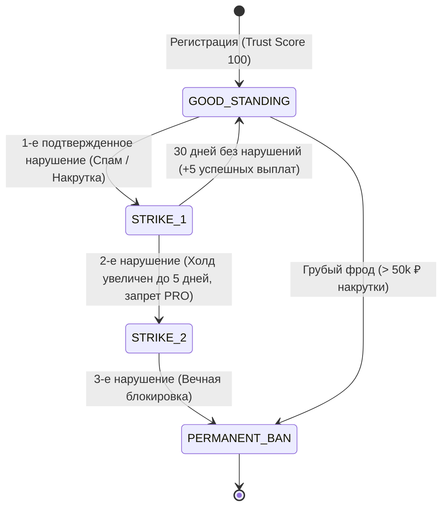

---
title: Штрафные санкции и черные списки (Penalties & Blacklisting)
type: antifraud
status: active
priority: high
created: 2026-10-31
updated: 2026-10-31
tags:
  - konveer
  - penalties
  - blacklisting
---

# 🚫 Штрафные санкции и система черных списков

## 1. Система предупреждений (Strike Policy)

Платформа использует систему трех предупреждений (3 Strikes Rule):

---

## 2. Параметры черных списков (Blacklist Attributes)

При получении вечной блокировки (`PERMANENT_BAN`) система вносит в черный список следующие идентификаторы:
1. **Telegram ID** пользователя.
2. **Номер телефона** СБП, использованный для вывода средств.
3. **ИНН** самозанятого.
4. **URL социального канала / аккаунта** (любые будущие сабмиты с этого YouTube/VK канала блокируются для всех пользователей платформы).
5. **Fingerprint браузера и IP-подсети**.

Связанные документы:
- [[06 - ANTI FRAUD/Fraud Detection Model & Risk Scoring|Скоринг рисков]]
- [[07 - LEGAL/Terms of Service & Privacy Policy|Пользовательское соглашение]]
