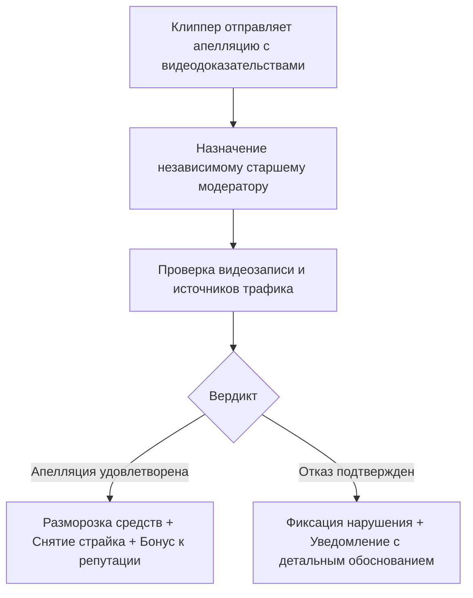

# Система Апелляций и Разрешения Споров (Appeals System)

Документ описывает регламент подачи, рассмотрения и вынесения решений по апелляциям клипперов в случае отклонения роликов или блокировки выплат.

---

## 1. Право на апелляцию и сроки

- Клиппер имеет законное право оспорить отклонение ролика или срез просмотров в течение **7 календарных дней** с момента вынесения вердикта.
- Подача апелляции осуществляется в 1 клик через Telegram Mini App по кнопке *«Оспорить решение»* в карточке отклоненного ролика.
- Повторная апелляция по одному и тому же инциденту после окончательного отказа не принимается.

---

## 2. Необходимые доказательства от клиппера

При подаче апелляции клиппер обязан предоставить:
1. Видеозапись экрана (Screen Recording) из творческой студии YouTube Studio или VK Клипов, где видна вкладка «Аналитика» с реальным графиком удержания и источниками трафика (разделы «Лента Shorts», «Рекомендации»).
2. Ссылку на первоисточник использованного монтажного проекта (скриншот таймлайна в CapCut / Premiere Pro).

---

## 3. Регламент рассмотрения апелляции

- Срок рассмотрения апелляции: **до 48 часов**.
- Если апелляция удовлетворена:
  - Сумма начисления моментально зачисляется на доступный баланс клиппера.
  - Ошибочный страйк аннулируется из базы данных.
  - Клиппер получает автоматический бонус +5% к репутации за содействие платформе.

---

## Связанные документы
- [[06 - ANTI FRAUD/Manual Moderation|Регламент ручной модерации]]
- [[06 - ANTI FRAUD/Violation History|История нарушений]]
- [[07 - LEGAL/Dispute Resolution|Юридический порядок разрешения споров]]
