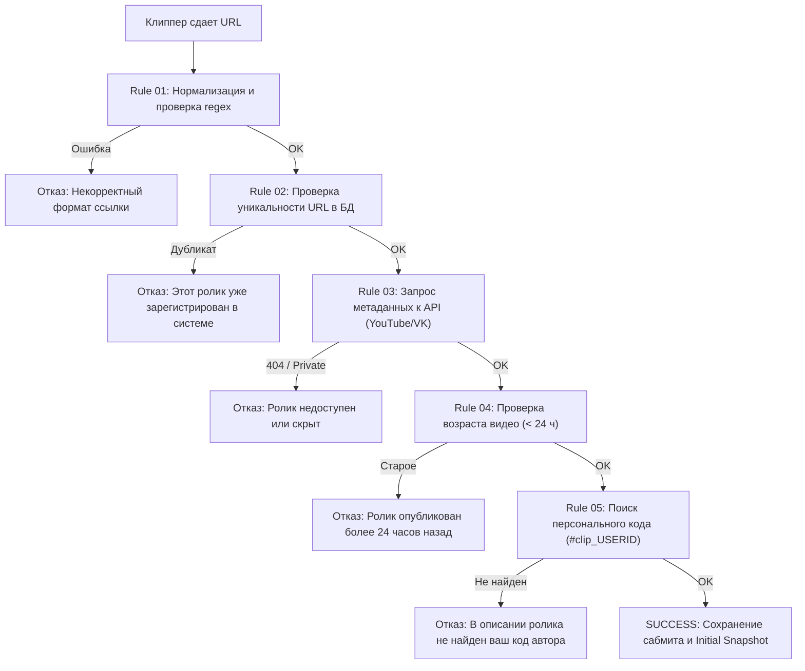

---
title: Автоматические правила верификации (Automated Verification Rules)
type: antifraud
status: active
priority: critical
created: 2026-10-31
updated: 2026-10-31
tags:
  - konveer
  - antifraud
  - rules
  - validation
---

# ⚙️ Автоматические правила верификации сабмитов

В данном документе формализованы правила предварительной и циклической валидации публикаций.

---

## 1. Пайплайн валидации сабмита в момент сдачи ($T_0$)

---

## 2. Матрица пороговых значений метрик качества

| Метрика | Минимальный допустимый порог | Порог предупреждения (Аудит) | Действие системы |
| :--- | :---: | :---: | :--- |
| **Engagement Rate (ER = Likes / Views)** | $\ge 1.5\%$ | $0.8\% \le ER < 1.5\%$ | Если $ER < 0.8\%$ при просмотрах $> 10\,000 \implies$ автоматическая блокировка начисления. |
| **Comment Ratio (Comments / Views)** | $\ge 0.05\%$ | $0.02\% \le CR < 0.05\%$ | Если на 50 000 просмотров 0 комментариев $\implies$ флаг накрутки. |
| **Отрицательная дельта ($\Delta V < 0$)** | $\Delta V \ge 0$ | Любое снижение | Если счетчик просмотров упал хотя бы на 100 $\implies$ ролик замораживается на ручной перерасчет. |
| **Минимальный порог монетизации** | 1 000 просмотров | — | Ролики, набравшие менее 1 000 просмотров, в расчет выплаты не идут (отсечение мусорного трафика). |

Связанные документы:
- [[06 - ANTI FRAUD/Fraud Detection Model & Risk Scoring|Скоринг рисков]]
- [[06 - ANTI FRAUD/Anti-Cheat & View Manipulation Defenses|Защита от накруток]]
