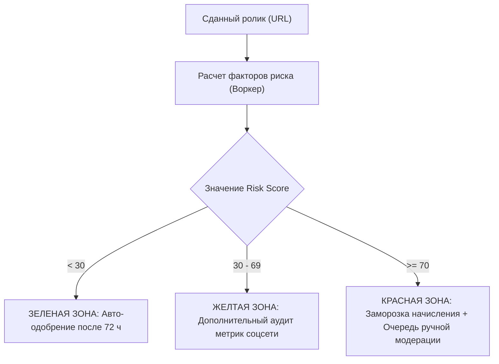

---
title: Модель детекции фрода и скоринг рисков (Fraud Detection & Risk Scoring)
type: antifraud
status: active
priority: critical
created: 2026-10-31
updated: 2026-10-31
tags:
  - konveer
  - antifraud
  - risk-scoring
  - security
---

# 🛡️ Модель детекции фрода и скоринг рисков (Fraud Scoring Model)

## 1. Концепция: Многофакторный индекс риска (Risk Score)

Каждому сданному видеоролику система динамически присваивает целочисленный рейтинг риска:
$$\text{Risk Score} \in [0, \; 100]$$

---

## 2. Математическая модель расчета Risk Score

$$\text{Risk Score} = \sum_{k=1}^{6} w_k \cdot F_k$$

Где $w_k$ — вес фактора, $F_k \in [0, 100]$ — нормализованная оценка подозрительности:

| Фактор ($F_k$) | Вес ($w_k$) | Описание аномалии | Логика начисления штрафных баллов |
| :--- | :---: | :--- | :--- |
| **$F_1$: Аномалия ER (Engagement Rate)** | 0.25 | Соотношение лайков к просмотрам | Если $\frac{\text{Likes}}{\text{Views}} < 0.5\% \implies F_1 = 100$. (У нормального шортса ER от 2.5% до 8%). |
| **$F_2$: Всплеск скорости (Velocity Spike)** | 0.25 | Мгновенный прирост на мертвом канале | Если на канале с 10 подписчиками пришло 50 000 просмотров за 30 минут без органического хвоста $\implies F_2 = 90$. |
| **$F_3$: Списание просмотров (Drop Rate)** | 0.20 | Падение счетчика просмотров | Если $V(t_2) < V(t_1)$ (соцсеть удалила бот-трафик) $\implies F_3 = 100$. |
| **$F_4$: Репутация автора (Account Trust)** | 0.15 | История аккаунта клиппера | Новый аккаунт, менее 3 успешных выплат $\implies F_4 = 40$; Были страйки ранее $\implies F_4 = 80$. |
| **$F_5$: Анализ комментариев (Comment Quality)** | 0.10 | Отсутствие или спам в комментариях | 100k просмотров и 0 комментариев, либо все комментарии от ботов вида «Nice», «Класс» $\implies F_5 = 70$. |
| **$F_6$: Дублирование контента (pHash)** | 0.05 | Перезалив чужого ранее сданного ролика | Совпадение перцептивного хэша видео $> 90\% \implies F_6 = 100$. |

---

## 3. Защита от ложных срабатываний (False Positives)

* **Проблема:** Иногда ролик органически вирусится так мощно, что алгоритм принимает его за накрутку (например, попал на главную страницу YouTube).
* **Решение:** 
  1. Автоматическая проверка источника трафика (если клиппер подключил OAuth канала).
  2. Временная заморозка вместо мгновенной блокировки: статус `MANUAL_REVIEW` не списывает деньги, а направляет ролик на 24-часовой разбор живому специалисту по антифроду.
  3. Возможность клиппера предоставить запись экрана со статистикой из YouTube Studio (с разбивкой по странам и типам источников).

Связанные документы:
- [[06 - ANTI FRAUD/Automated Verification Rules|Автоматические правила проверки]]
- [[06 - ANTI FRAUD/Anti-Cheat & View Manipulation Defenses|Защита от накруток]]
- [[06 - ANTI FRAUD/Manual Moderation & Appeals|Модерация и апелляции]]
