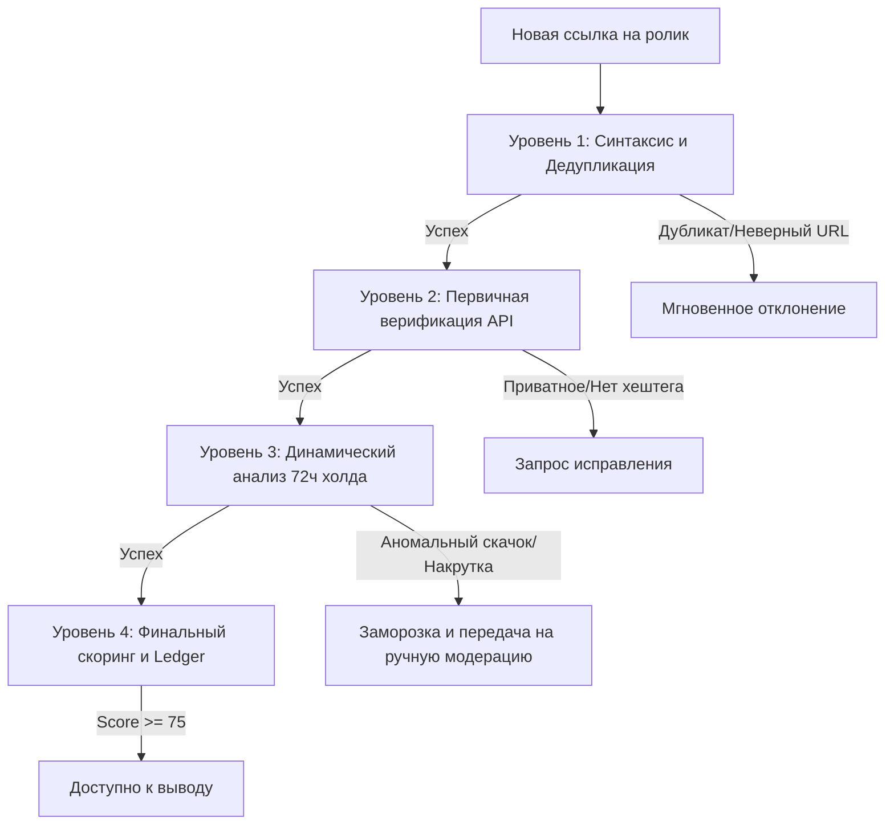

# Модель Обнаружения Фрода (Fraud Detection Model)

Документ описывает математическую и алгоритмическую модель выявления недобросовестных действий со стороны клипперов и рекламодателей на платформе Konveer.

---

## 1. Архитектура многоуровневого анализа

Система защиты состоит из 4 последовательных фильтров:

---

## 2. Типология атак и алгоритмы обнаружения

### 1. Накрутка ботами через буксы и сервисы накрутки (SMM Panels)
- **Принцип атаки**: Клиппер покупает 50 000 просмотров за 100 ₽ на стороннем сервисе (боты с эмуляцией просмотров), чтобы получить от платформы 4 000 ₽.
- **Детекция**:
  - **Аномальный показатель Engagement Rate ($ER$)**: В реальных YouTube Shorts и VK Клипах отношение лайков к просмотрам находится в коридоре **2.5% – 8.0%**. При накрутке ботами $ER$ падает ниже 0.4% (например, 50 000 просмотров и 12 лайков) либо число лайков аномально высоко без комментариев.
  - **Анализ профиля скорости (Velocity Spike)**: Боты накручивают просмотры «ступенькой» (+10 000 просмотров за 15 минут, затем полная тишина). Органический вирусный трафик имеет плавную экспоненциальную кривую набора с длинным «хвостом» досмотров.

### 2. Срез просмотров алгоритмами платформ (Bot Purge Recognition)
- **Принцип**: YouTube и VK анализируют качество трафика и списывают накрученные просмотры в течение 24–48 часов после их совершения.
- **Детекция**: Наш синхронизатор фиксирует отрицательную дельту ($\Delta V < 0$). Любая отрицательная дельта просмотров свыше 5% автоматически помечает ролик флагом `FRAUD_VIEW_PURGE` и аннулирует начисление за списанный объем.

### 3. Дублирование и перезаливы чужих роликов (Content Theft & Reupload)
- **Принцип**: Один клиппер крадет популярный монтаж другого клиппера и публикует на своем канале, пытаясь заработать на чужой работе.
- **Детекция**:
  - Вычисление перцептивного хэша видео (pHash) первых 5 секунд ролика и сравнение с базой всех роликов кампании.
  - Проверка уникальности аудиодорожки (аудио-отпечаток).
  - При совпадении свыше 85% принимается только ролик с более ранней меткой времени публикации `publishedAt`.

---

## Связанные документы
- [[06 - ANTI FRAUD/Risk Scoring|Алгоритм Risk Scoring]]
- [[06 - ANTI FRAUD/Automated Verification Rules|Правила автоматической проверки]]
- [[06 - ANTI FRAUD/Payout Freezing|Заморозка начислений]]
- [[06 - ANTI FRAUD/Manual Moderation|Регламент ручной модерации]]
