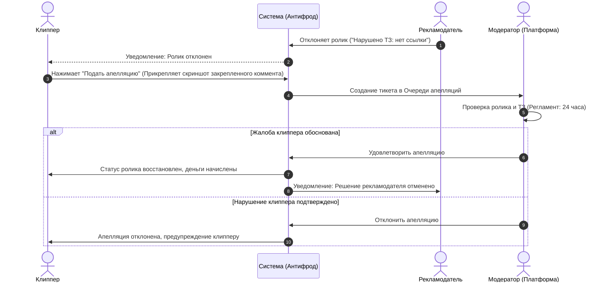

---
title: Ручная модерация и процедура апелляций (Manual Moderation & Appeals)
type: antifraud
status: active
priority: medium
created: 2026-10-31
updated: 2026-10-31
tags:
  - konveer
  - moderation
  - appeals
  - disputes
---

# ⚖️ Ручная модерация и процедура апелляций

## 1. Процедура разрешения споров (Dispute Resolution Flow)

---

## 2. Регламент и SLA модерации
1. **Время рассмотрения апелляции:** Не более **24 часов** с момента подачи клиппером (для пользователей PRO — до **6 часов**).
2. **Презумпция добросовестности:** При спорных ситуациях по органическим просмотрам платформа запрашивает у автора запись экрана творческой студии (YouTube Analytics / VK Видео) с аналитикой источников трафика.
3. **Беспристрастность:** Если рекламодатель систематически необоснованно отклоняет качественные ролики клипперов с целью экономии бюджета, его кампания принудительно останавливается, а рейтинг доверия аккаунта снижается.

Связанные документы:
- [[02 - PRODUCT/Admin Panel Specification|Админ-панель]]
- [[06 - ANTI FRAUD/Account Penalties & Blacklisting|Штрафы и санкции]]
