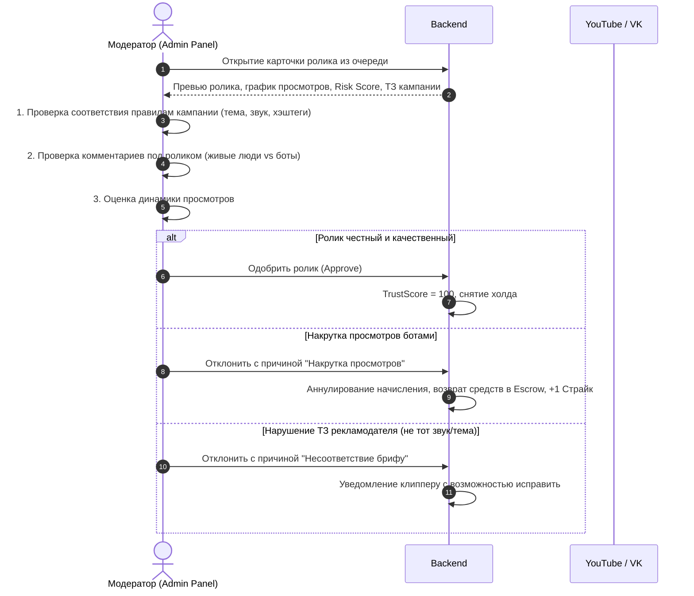

# Регламент Ручной Модерации (Manual Moderation)

Документ описывает стандартные операционные процедуры (SOP) для сотрудников службы модерации и безопасности платформы Konveer.

---

## 1. Источники попадания в очередь модерации

Ролик или аккаунт попадает на ручную проверку в следующих случаях:
1. **Желтая зона Risk Score** ($50 \le \text{Score} < 75$).
2. **Аномально крупная сумма начисления**: выплата свыше 10 000 ₽ за один ролик.
3. **Жалоба от рекламодателя**: рекламодатель нажал «Пожаловаться на качество / несоответствие ТЗ» в своем кабинете.
4. **Смена реквизитов выплат**: клиппер привязал новый номер СБП перед запросом крупной выплаты.

---

## 2. Пошаговый алгоритм проверки ролика модератором

---

## 3. SLA и нормативы скорости работы

- **Максимальное время нахождения в очереди ручной проверки**: не более **24 часов** с момента попадания.
- Если модератор не вынес решение за 24 часа, а грубых аномалий в логах нет — система отправляет эскалацию старшему смены (Lead Moderator).

---

## Связанные документы
- [[06 - ANTI FRAUD/Appeals|Система апелляций]]
- [[06 - ANTI FRAUD/Risk Scoring|Скоринг рисков]]
- [[02 - PRODUCT/Admin Panel Specification|Спецификация административной панели]]
