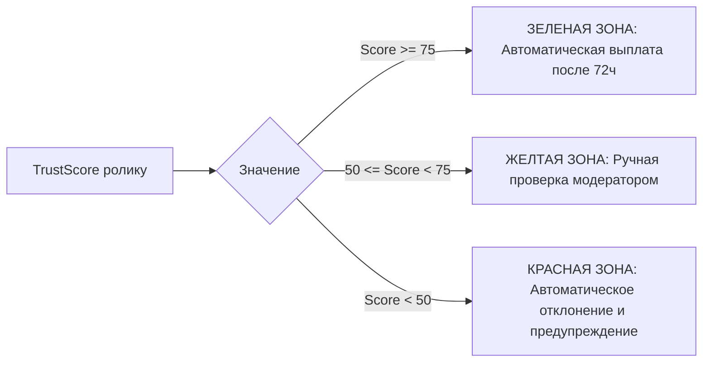

# Математическая Модель Скоринга Риска (Risk Scoring)

Документ формализует вычисление интегрального индекса доверия к ролику $Score \in [0, 100]$. Только ролики с баллом выше установленного порога допускаются к разморозке начислений.

---

## 1. Формула вычисления интегрального скоринга

Итоговый балл доверия к ролику вычисляется как взвешенная сумма 5 независимых факторов:

$$\text{TrustScore} = \sum_{i=1}^5 w_i \times F_i$$

Где сумма весов $\sum w_i = 1.0$:

| Фактор | Название метрики | Вес ($w_i$) | Логика нормализации в шкалу $[0, 100]$ |
| :--- | :--- | :--- | :--- |
| **$F_1$** | **Engagement Rate ($ER$)** | **0.30** | $ER = \frac{\text{Likes} + 2 \times \text{Comments}}{\text{Views}} \times 100\%$. Если $ER \in [2.5\%, 8.5\%] \to 100$; если $ER < 0.5\% \to 0$. |
| **$F_2$** | **Гладкость прироста (Velocity Curve)** | **0.25** | Анализ производной прироста по часам. Отсутствие аномальных прямоугольных ступеней $\to 100$. |
| **$F_3$** | **Списания платформой (Purge Delta)** | **0.20** | Отсутствие отрицательной коррекции просмотров со стороны YouTube/VK $\to 100$. |
| **$F_4$** | **Репутация клиппера (Author Karma)** | **0.15** | История успешных выплат, стаж аккаунта, доля одобренных роликов ранее. |
| **$F_5$** | **Проверка уникальности (pHash)** | **0.10** | Уникальный монтаж и аудиодорожка $\to 100$. Частичный дубликат $\to 0$. |

---

## 2. Пороговые значения и автоматические решения

- **Зеленая зона ($\ge 75$ баллов)**: Начисление переходит из `PENDING` в `AVAILABLE` автоматически ровно через 72 часа.
- **Желтая зона ($50–74$ балла)**: Ролик автоматически отправляется в очередь ручной проверки сотрудникам службы безопасности. Клиппер видит статус *«Дополнительная проверка качества»*. Модератор имеет 24 часа на вердикт.
- **Красная зона ($< 50$ баллов)**: Начисление аннулируется, средства возвращаются в Escrow кампании рекламодателю, клиппер получает страйк (предупреждение).

---

## Связанные документы
- [[06 - ANTI FRAUD/Fraud Detection Model|Модель обнаружения фрода]]
- [[06 - ANTI FRAUD/Automated Verification Rules|Правила автоматической проверки]]
- [[06 - ANTI FRAUD/Manual Moderation|Регламент ручной модерации]]
- [[06 - ANTI FRAUD/Violation History|История нарушений и страйки]]
