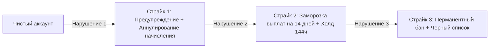

# История Нарушений и Система Страйков (Violation History)

Документ описывает систему накопления нарушений (Strike System), штрафных санкций и понижения репутации клипперов и рекламодателей.

---

## 1. Система Страйков для клипперов (3 Strikes Policy)

Платформа применяет прозрачную прогрессивную шкалу ответственности:

### Детализация уровней ответственности:
1. **Страйк 1 (Предупреждение)**:
   - Причина: Первая подтвержденная накрутка просмотров ботами или залив чужого ролика.
   - Санкция: Аннулирование вознаграждения за конкретный ролик. Деньги возвращаются рекламодателю. Проводится воспитательное уведомление в боте.
   - Сгорание: Страйк сгорает через 90 дней безупречной работы.
2. **Страйк 2 (Ограничение функционала)**:
   - Причина: Повторный инцидент накрутки в течение 90 дней.
   - Санкция: Временная блокировка вывода средств на 14 дней. Увеличение стандартного срока холда для всех последующих роликов с 72 до 144 часов (6 суток). Понижение рейтинга клиппера в каталоге.
3. **Страйк 3 (Перманентный бан)**:
   - Причина: Систематический фрод, попытка взлома API или создание сети мультиаккаунтов.
   - Санкция: Перманентная блокировка аккаунта. Внесение реквизитов (Telegram ID, ИНН, телефон СБП, отпечаток устройства) в единый Черный список (Blacklist).

---

## 2. Логирование и неизменяемость истории нарушений

Каждое нарушение фиксируется в системной таблице `moderation_strikes`:
- `id`: UUID записи.
- `user_id`: ID нарушителя.
- `violation_type`: Код нарушения (`BOT_VIEW_BOOST`, `PLAGIARISM_REUPLOAD`, `OFFENSIVE_CONTENT`, `TOS_BREACH`).
- `evidence_snapshot`: Ссылка на архив доказательств в S3 (скриншоты, JSON ответов API, логи подозрительных IP).
- `issued_by`: ID модератора либо `SYSTEM_AUTOBAN`.
- `created_at`: Метка времени.

---

## Связанные документы
- [[06 - ANTI FRAUD/Banning Rules|Правила блокировок]]
- [[06 - ANTI FRAUD/Appeals|Апелляции и снятие страйков]]
- [[02 - PRODUCT/Admin Panel Specification|Админ-панель: Модерация]]
