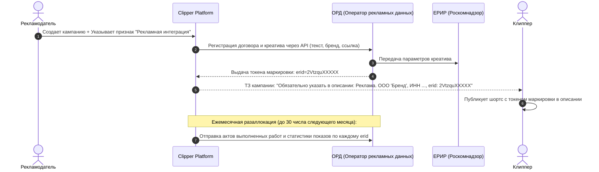

---
title: Закон о рекламе и интеграция с ОРД (347-ФЗ и ЕРИР)
type: legal
status: active
priority: critical
created: 2026-10-31
updated: 2026-10-31
tags:
  - konveer
  - legal
  - ord
  - erir
  - 347-fz
---

# 📢 Закон о рекламе и интеграция с ОРД (347-ФЗ, ЕРИР, РКН)

## 1. Законодательный контекст в РФ (ФЗ № 347-ФЗ)

С 1 сентября 2022 года вся цифровая реклама, направленная на пользователей в РФ, подлежит обязательной маркировке и передаче данных в **Единый реестр интернет-рекламы (ЕРИР)** Роскомнадзора через уполномоченных **Операторов рекламных данных (ОРД)**. С 1 сентября 2023 года вступили в силу штрафы (ст. 14.3 КоАП РФ):
* Для физлиц (клипперов): от 30 000 до 100 000 ₽.
* Для юрлиц (рекламодателей и платформы): от 200 000 до 500 000 ₽ за каждый незамаркированный креатив!

---

## 2. Разделение типов контента: Реклама vs Творческий контент

Федеральная антимонопольная служба (ФАС России) разъясняет:
1. **ЯВЛЯЕТСЯ РЕКЛАМОЙ:** Ролик, содержащий призыв купить конкретный товар (например, худи бренда X по промокоду Y на Wildberries), прямую ссылку на магазин, цену, выделение одного товара среди аналогичных.
2. **НЕ ЯВЛЯЕТСЯ РЕКЛАМОЙ (Органический контент):** Нарезка смешного момента со стрима или подкаста, где блогеры просто обсуждают новости, играют в игру или высказывают личное мнение без интеграции спонсора.

---

## 3. Схема сквозной автоматической маркировки платформой

Для рекламных кампаний платформа выступает **Рекламной системой / Агентом по маркировке**, полностью автоматизируя процесс через API ОРД (**ОРД-А / ОРД VK**):

### Преимущество платформы:
Рекламодатель освобождается от кошмара ручной маркировки сотен шортсов. Платформа берет на себя формирование разаллокаций по клипперам и закрывает все риски штрафов.

Связанные документы:
- [[07 - LEGAL/Legal Structure & Regulatory Compliance (RU)|Юридическая структура]]
- [[05 - INTEGRATIONS/Social Media APIs Overview & Feasibility Matrix|Матрица API]]
