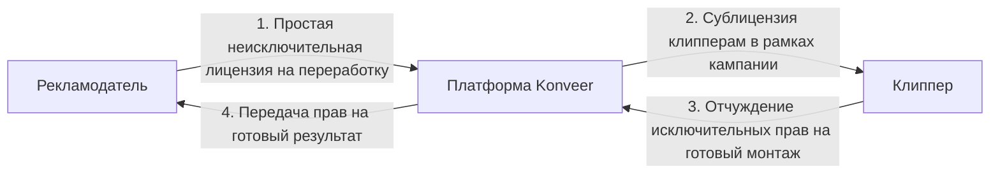

# Интеллектуальная Собственность и Лицензирование (Часть 4 ГК РФ)

Документ описывает юридический механизм передачи прав на контент между рекламодателем, платформой и клиппером в рамках Части IV Гражданского кодекса РФ (ст. 1225–1302 ГК РФ).

---

## 1. Юридическая цепочка прав на материалы

Создание клипов из чужих видеоматериалов (стримов, подкастов, рекламных роликов) представляет собой создание **производного произведения** (ст. 1260 ГК РФ — переработка произведения). Для исключения судебных исков и страйков по авторским правам применяется следующая цепочка:

---

## 2. Сублицензионный договор с клиппером
В момент нажатия кнопки *«Участвовать в кампании»* клиппер акцептует условия сублицензии:
- **Разрешенные способы использования**: Переработка (нарезка, цветокоррекция, наложение субтитров, добавление звуковых эффектов из одобренной библиотеки) и публичное размещение на платформах YouTube Shorts, VK Клипы, TikTok с указанием рекламных меток и ссылок рекламодателя.
- **Территория**: Весь мир.
- **Срок**: На срок проведения рекламной кампании плюс 3 года с момента публикации.
- **Запрет**: Запрещено использовать исходные материалы в иных коммерческих целях или для порочащего рекламодателя контекста.

---

## 3. Статус информационного посредника (ст. 1253.1 ГК РФ)
Платформа Konveer действует как **информационный посредник**:
- Платформа не инициирует создание конкретного монтажа и не выбирает получателя.
- Платформа не изменяет содержание видеороликов клипперов.
- При получении обоснованной претензии правообладателя (DMCA / Notice-and-Takedown) платформа обязана своевременно заблокировать доступ к спорным материалам и заморозить выплаты до разрешения спора.

---

## Связанные документы
- [[07 - LEGAL/Content Usage Permissions|Разрешения на использование контента]]
- [[07 - LEGAL/Terms of Service|Пользовательское соглашение]]
- [[07 - LEGAL/Platform Liability|Ответственность платформы]]
